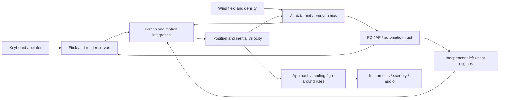

# Physics foundation

The browser game now uses a reduced-order, force-integrated aircraft model.
It remains an entertainment exercise, with synthetic coefficients and keyboard
fly-by-wire rate servos. It is not an A320 performance model or complete rigid-
body six-degree-of-freedom simulator. The ordered curriculum now drives deterministic engine-out and windshear
tasks through these modules. Random compound failures, engine restart
procedures and emergency electrical/hydraulic systems remain deferred.

## Update flow

`flight.js` orchestrates the modules and retains task rules. All model modules
are independent of React, Three.js and browser APIs. The browser advances
`advanceSimulation` at 100 Hz using an accumulated remainder; rendering and
UI publication run separately. Mission triggers run before physical integration;
mission outcomes are checked after it. Their state is serialized in checkpoints. Each tick samples weather, updates controls,
computes guidance/engine output, changes attitude through rate servos,
integrates forces, refreshes air data and evaluates the mission.

| Module | Responsibility |
| --- | --- |
| `game/src/sim/constants.js` | Units, coordinates, mass, synthetic airframe parameters |
| `weather.js` | Wind vector, density, deterministic gust/shear fields, runway friction |
| `aerodynamics.js` | Relative air velocity, IAS/TAS/groundspeed, angle of attack, sideslip, lift/drag, trim estimate |
| `engines.js` | Independent engine status, spool delay, N1, thrust, available capacity and asymmetric moment |
| `controls.js` | Spring-centred stick/rudder input and simplified pitch/roll rate servos |
| `guidance.js` | FD targets, wind correction, power-limited climb demand |
| `dynamics.js` | Lift/drag/gravity/thrust forces, ground friction, yaw/rudder coupling and integration |

## Conventions and state

All integration uses SI units. Position: x is runway-right, y is up, z is the
approach side. At yaw 0 the aircraft flies toward negative z (runway heading
270 degrees). Positive yaw/roll turns right; positive pitch raises the nose.
Wind direction is the compass bearing the wind comes **from**. Wind vectors
and gust amplitude are metres/second; the configured steady wind is knots.
`weight` is tonnes and contributes to mass, trim, lift loading and acceleration.

- `velocity`: inertial world velocity in x/y/z. This is the translational
  state integrated by the model; attitude and targets never assign it in flight.
- `airData`: wind, density, relative velocity, true airspeed, IAS approximation,
  flight-path angle, air/ground track, groundspeed, angle of attack, sideslip,
  dynamic pressure, lift/drag coefficients and forces, load factor and energy.
- `speed`: derived IAS approximation in m/s, retained for controls/instruments.
  It uses TAS multiplied by the square root of density ratio (equivalent-speed
  approximation); compressibility, pitot errors and temperature are omitted.
- `verticalSpeed`: derived world vertical velocity. Wind affects relative
  airflow; an updraft does not instantaneously teleport vertical velocity.
- `engines[0/1]`: left/right status (`running`, `off`, `failed`), health,
  optional individual lever override, command, spool, illustrative N1 and
  signed thrust in newtons. `thrust` is a derived aggregate for compatibility.
- `controls`: rudder demand/trim/applied position, default assistance and
  pitch/roll rate commands. Q/E command rudder; assistance yields to manual
  pedal input. The help panel allows assistance to be disabled.
- `forces`: last integrated world-force components, lift, drag, thrust and weight.
- `clock.accumulator`: fractional tick remainder, included in phase snapshots.

Phase retry deep-copies this state and clears held stick/pedal demands.
Weather fields use analytic functions of position, simulation time and seed,
so retry uses the same weather without random render-frame dependence.

## Physical model and boundaries

The core uses `L = q S CL`, `D = q S CD`, `q = rho V² / 2` and `a = F / m`.
Lift is perpendicular to relative airflow and rotates with bank; drag opposes
relative velocity. Gravity acts downward and thrust follows body heading and
pitch. Forces, rather than an assigned descent rate, change velocity and
position. The polar includes configuration, induced drag, sideslip and an
extra drag term for non-running engines, with a smooth post-stall lift falloff.

Pitch/roll retain the approved keyboard-friendly rate response, neutral bank
hold and simplified bank protection. Yaw has an integrated rate, aerodynamic
restoring/damping terms, bank coordination, an asymmetric engine moment and
rudder moment. This is a coupled reduced-order model; full inertias, flexible
surfaces, flight-control laws, exact rudder authority and high-angle departure
physics are not represented.

Automatic thrust distributes demand over available engines within lever
limits. Failed/off engines produce no thrust and cannot be re-powered by
speed demand. FD/AP command attitude through the same controls; their climb
target is bounded by available power. The speed target is not a guarantee:
insufficient power or excessive pitch can still cause speed loss/stall.

Ground contact supplies a normal reaction. Gear/spoilers affect the model,
wheel braking is bounded by available friction, and reverse comes from the
running engines. Stopping is judged by **groundspeed**, so a stationary
plane in wind can legitimately show nonzero airspeed. Runway contact remains a flat surface. Shared triangle-heightfield collision
now detects terrain/water contact with swept body/wing/nose probes and freezes
the failed flight at impact. Detailed building/vegetation collision, survivable
ditching, tire slip curves and landing-gear suspension remain outside scope.
The 64 t VAPP/configuration limits remain fixed task presets; changing mass
in a model test does not perform a certified landing-speed calculation.

Normal-task weather is the existing 5 kt headwind. The windshear lesson
adds a smooth, localized elliptical wind disturbance with altitude fade; its
strength is sampled by both the physics and task controller. Gust/shear/
friction remain extensible; there is no general weather editor. The photographic cockpit frame and mounted instruments share a small visual
head-motion transform; the flight state remains separate from that transform.

## Extension APIs

`createFlight(mode, {scenario, landingConfig, weight, weather})` supplies initial
conditions. `setWeather(state, patch)` changes the air mass while preserving
inertial velocity. `setEngineStatus(state, index, status)` changes independent
engine availability; it does not implement an operational restart procedure.
`setMotion(state, {speed, verticalSpeed, yaw})` is an explicit initial-placement
helper for scenarios/tests, not a live flight controller.

For example, a headless model test can create a crosswind field or turn off
one engine. These functions are module APIs, not hidden keyboard cheats. The
`missions/catalog.js` curriculum and `missions/runtime.js` controller now use
them for initial presets, one-shot triggers, alerts, configuration hold,
escape detection, continuous stability, task-specific outcomes and scoring.
`missions/progress.js` validates optional local browser records separately
from physical/checkpoint state. Phase retries restore events and environment,
but are marked as practice so they do not write whole-level scores.

## Verification

`npm --prefix game run test:flight` runs the normal exercises and physics
invariants. Coverage includes complete full/short/CONF 3 approaches, go-around,
takeoff, control signs/return, independent engines, mirrored failure yaw,
rudder assistance, wind-vector identities, inertial continuity, mass effects,
post-stall lift, power-off energy loss, wet-friction stopping and reproducible
checkpoint/timestep behavior. Browser checks verify actual keys and live UI.

Equation references (these support the model form, not its synthetic coefficients):

- [NASA Glenn: lift equation](https://www1.grc.nasa.gov/beginners-guide-to-aeronautics/lift-equation/)
- [NASA Glenn: drag equation](https://www1.grc.nasa.gov/beginners-guide-to-aeronautics/drag-equation/)
- [NASA Glenn: relative velocity](https://www1.grc.nasa.gov/beginners-guide-to-aeronautics/relative-velocity/)

## Expanded missions, system capabilities and circuit

`sim/systems.js` separates availability from the crew-selected modes. A/THR
failure holds the last engine commands until a lever match or deliberate
detent override. Failed availability survives normal ON selections. ILS loss
invalidates LOC/G/S and disconnects approach guidance; surviving HDG/ALT never
uses hidden runway geometry. Flap jam freezes actual actuator position.
The game CONF 2 task resets VAPP to 165 kt; no performance calculator exists.

`missions/route.js` projects the current continuous position onto five fixed
legs and uses a lookahead point. Leg completion requires proximity/progress;
the initial turn also requires 1100 ft. Guidance commands attitude via the
existing servos. No waypoint transition assigns position or velocity. The
route ends by following the runway extension rather than chasing the threshold
after crossing it. Single-engine return uses the same route without clearing
its failed engine. Real approach gates begin only on the final leg.

Dual-engine glide starts clean at 2800 ft / 10.5 km, 650 m left of the
runway and 10 degrees off runway heading. Both engines fail
after two seconds; automatic speed control, AP, reverse and powered go-around
remain unavailable. Simplified battery/control authority and a game glide FD
are retained. Sink demand derives from drag and energy, with a speed-error
pitch correction; lateral glide FD uses the runway/map bearing and wind
correction without ILS capture. Actual forces still determine motion. Flare begins near
80 ft for this synthetic high-drag scenario. The ND range estimate uses the
synthetic polar, current configuration, height and wind, not a certified glide
performance database. Detailed relight, RAT, electrical/hydraulic degradation
and flight-control law changes remain outside scope.

Weather presets now drive rain, fog/visibility and overcast in rendering as
well as vector wind/gusts and wet-runway friction in physics. The minimum is a fictional game threshold. Safe recovery is an intermediate
stage: the level stays active until the subsequent visual landing and stop.
Late decisions can recover and land, with a score deduction. Jammed-flap go-arounds allow the actual stuck setting
so task cleanup cannot demand an impossible actuator position.

Radio state is independent of aircraft control and never alters flight forces.
Its event queue uses simulation time, deduplication and checkpoint history;
media playback observes that queue, shared pause/mute and time scale. Recorded
height/safety clips duck dialogue. Self-hosted assets avoid runtime dependence
on remote synthesis or available operating-system voices.

## Terrain awareness and clearance monitoring

`terrain/heightfield.js` owns the render-grid dimensions and vertex heights.
`world.js` draws those exact vertices. Physics samples the same triangle
interpolation (not a separate smooth formula), including the coast. Swept
probes use <=8 m spacing plus a binary impact refinement, covering the fuselage,
nose and banked wing tips. Impact runs before route progress or landing success;
no later tick can move a result state. Tests compare the height query with
raycasts against an actual Three.js mesh.

The PFD RA now samples real ground/sea below the aircraft. The main altitude
tape and 1500 ft task/ATC clearances remain airport-reference game heights.
The 1500 ft circuit is explicitly sea-side with a left turn; normal and
single-engine complete flights keep over 1000 ft of terrain clearance once
above 1100 ft on the circuit, rather than assuming 1500 ft is safe everywhere.

The toy terrain predictor checks 30 seconds of current ground track, turn
rate and vertical motion, using a narrow forward fan. Caution precedes urgent
PULL UP (15-second contact / near-clearance envelope), with repeat cooldown
and clear hysteresis. Normal low, aligned, configured runway arrivals are
inhibited; elevated terrain is always checked, regardless of gear or APPR.
It is a game safety aid, not certified GPWS/EGPWS or a navigation database.

ATC stores a live clearance, phase grace, sustained-deviation timers,
notifications and recovery state. It monitors actual altitude, heading and
route geometry; choosing an FCU value or playing a readback never substitutes
for compliance. Reminders can repeat after 25 s and expire instead of playing
against a superseded clearance. Engine/emergency conversations keep priority.
The base leg explicitly clears 1250 ft, replacing the earlier 1500 ft circuit
height. A final-turn grace prevents normal base-to-final intercept warnings.

Terrain danger temporarily supersedes ordinary altitude compliance. Powered
FD/AP requests a terrain-safe altitude through the existing attitude servos
and power limit; the selected FCU value and manual inputs are untouched. A
temporary terrain floor is released only after safe terrain and route recovery.
No geometry or engine power is changed to make an escape succeed.

Radio DSP processes only the pilot/tower media source, with band-pass,
compression, gentle saturation, gated carrier noise and PTT clicks. Height
and safety cues retain a separate clean path; urgent GPWS/windshear cues
cannot be displaced by lower-priority height calls. Pause/mute/reset zero
the carrier. Browser QA checks decoded voice, output signal RMS, carrier gain,
PTT events and quiet pause/mute in addition to subtitles.

Active radio clips follow the media clock without repeated current-time seeks.
This preserves pause continuation on simple static hosts without HTTP Range
support. Event expiry removes stale lines; rate/pause controls handle ordinary
clock alignment. Carrier gating discards stale gain automation on pause/reopen.

## Correcting final-approach nuisance alerts

The original landing inhibit required |x| <90 m. A normally descending final
with 120–180 m of lateral error being corrected toward centerline therefore
predicted contact with the flat airport as a terrain conflict, including a
PULL UP at about 222 ft / 1 km. It could also introduce an unnecessary ATC
terrain floor and command a climb out of an otherwise recoverable approach.

The inhibit now tests a bounded arrival envelope narrowing toward the runway,
closing ground track, actual gear, plausible descent/bank and longitudinal
contact near/within the runway. Brief lateral corrections are not extrapolated
unchanged to touchdown; lateral landing accuracy remains the approach monitor's
responsibility. Expected low airport contact is excluded only in that envelope.
Raised terrain (>5 m) remains in the forward samples even for a valid arrival.
Undershoot, excessive descent, gear-up and missed approach still warn. Tests
include both sign lateral errors, a real-control full circuit with >90 m
correction, bank rollout, a synthetic ridge in the arrival path and unchanged
real hillside collision/alerts. This remains an illustrative game envelope.

## Unprepared arrival entries and cabin motion

`missions/arrival.js` centralizes all ten playable airborne start profiles.
They begin offset from the runway with an intercept heading, clean physical
actuators and no preset ILS capture, gate success or checklist confirmation.
Full ILS starts 22 km out / 3000 ft; shorter powered entries are 10.5–12 km /
1500 ft. Initial placement is followed by the normal air-data/trim/spool
initialization, rather than a controller moving the aircraft onto final.
Takeoff/circuit levels retain their continuous runway starts. Bare
`createFlight('landing')` configured presets remain internal model fixtures;
UI levels always supply `levelId` and pass through the clean initializer.

Touchdown records actual gear/flap positions and checklist state. Normal
landing and fault completion validate this record, so late switch changes
do not satisfy preparation. The emergency dual-glide lesson checks its
actual gear/CONF 1 instead of requiring the normal powered landing checklist.
Go-around instructions wait for approximately 800 ft; the jam trigger waits
for physical CONF 2 before freezing the actuator on attempted extension.

`sim/cabin-motion.js` samples deterministic, purely visual head motion from
simulation time, speed, wind, touchdown descent and nose-wheel contact.
A damped main-gear impact, smaller nose-wheel impact, ground rumble and
weather buffeting drive the same cockpit rig and Three.js camera. The
stable UI overlays remain outside the rig. Pausing freezes the pose; retry
reproduces it from saved time/contact/weather state. No visual transform
changes aircraft attitude, velocity, contact or sensor readings.

Weather also supplies small seeded pockets roughly once per 55-second
cycle, with a 2.5–3.7 second envelope and calm gaps. The wind field applies
the physical air-mass component (up to 0.2 m/s at normal strength); visual
level-flight response is limited to above 1000 ft, low bank and low vertical
speed. Existing stronger gust/shear fields remain actual aerodynamic inputs.
Standard / 0.35 reduced / off applies only to visual head motion, is saved
locally and initially honors prefers-reduced-motion. Changing the setting
does not remove weather forces or recreate the aircraft/audio simulation.

## Stall alerts and continuous missed approaches

`sim/stall-warning.js` observes the same configuration-dependent lift peak as
`aerodynamics.js`. It never changes lift, pitch or velocity. Warning thresholds
are 85%/95% critical AoA, with an active-warning clear threshold of 78% held
for 0.6 seconds. The red event repeats at three-second simulation intervals;
state and timers are checkpointed. Ground/landed/result states inhibit it.
The PFD and HUD stay visible alongside terrain warnings, and the clean stall
clip takes priority over ordinary height cues. Recovery removes a queued or
paused stale stall clip. Radio is ducked during safety speech.

`missions/recovery.js` handles all landing-required levels after TOGA. It
observes actual 3000 ft / 150–220 kt / gear / flap cleanup and three seconds
of stability (five for windshear), allowing the actual jammed setting. It then issues a coastal
return route from the current location; it never assigns position, velocity,
engine status or repairs system capabilities. The route uses sea-side points,
3000/2500/2200 ft descent stages and a base/final intercept. Full ILS uses a
longer 14 km base at 1500 ft for a genuine capture from below; normal returned
arrivals use 10 km / 1750 ft map guidance. Wrapped heading is required for LOC
capture after a whole circuit. An ILS-loss final disconnects AP/FD and remains
visual. New approach gates, height calls and checklist do not inherit success
from the aborted final. Physical touchdown configuration remains required.

Fog visibility/cloud base improve smoothly over 60 seconds after safe recovery;
the windshear field fades on the same schedule after escape. This deterministic
weather progression permits a later landing without resetting the aircraft.
The explicit go-around drill remains a climb/cleanup lesson; all other arrival,
circuit and fault missions continue until real landing and stopping. Only the
three prior go-around-clearing lesson revisions invalidate their old records.

Recovery legs keep their own live ATC altitudes; they do not reuse the original
1500/1250 ft circuit voice clearances. The initial return instruction and final
landing exchange remain automatic. This prevents radio/HUD altitude conflicts.

## Ground-contact go-around

TOGA can now enter the go-around procedure after a valid touchdown during
rollout. `landed` remains the wheel-contact state while `goAround` permits
manual pitch control and a new lift-off. Selecting TOGA retracts spoilers,
cancels reverse and releases automatic braking, without repairing failed
systems or assigning velocity, position or engine spool. Manual brakes remain
active while held. The normal force-based lift-off condition in dynamics
releases the wheels; only then does `landed` clear. Ground gear retraction
remains blocked. The previous contact is archived in `landingAttempts`, while
the current touchdown and nose contact are cleared on lift-off so only the
subsequent real landing can finish the mission. Retry preserves these states.
Touch-and-go is a game simplification and does not model detailed reverser
actuation, brake temperature or aircraft operational rejected-landing limits.

During a touch-and-go recovery, passing 1100 ft changes only the requested
ground track to a sea-side left turn while the real climb continues to 3000
ft. ATC amends the heading with turn grace. This protects the longer
single-engine climb without adding thrust or relocating the aircraft.

## Radio emergency severity

`comms/emergency.js` observes actual fixed-tick state and updates only radio
state. Fixed first declarations cover low takeoff engine loss, double failure
and flap jam; controllable manual-thrust or signal-loss procedures remain
ordinary fault reports. Transient escalation uses sustained low-height stall /
vertical energy loss or imminent terrain prediction, with hysteresis/timers.
A single failed engine can downgrade only after 20 s stable above 1200 ft;
transient distress cancellation needs 15 s safe recovery. These are synthetic
game thresholds, not aircraft operating limits or mandatory real-world fault
classifications. Snapshot/retry includes monitor and declaration state.

Queued declarations carry severity and 4/3 priority above 2 fault reports,
1 ATC reminders and 0 routine traffic. Pending high-priority declarations keep
their initial safety-call grace; lower traffic cannot reset that delay or
interrupt their acknowledgement. A higher-severity event may supersede lower
traffic. Resolved transient distress restores any underlying urgency. Radio
classification never supplies thrust, repairs systems, moves the aircraft or
substitutes for actual flight/ATC compliance. The MP3 builder uses the identical pilot voice/pitch for both the signal
and Mandarin body, joining exactly three spoken signal units; waveform QA
checks the actual encoded repetitions as well as the caption strings.

Signal cadence trims only boundary silence, retains internal word pauses,
and uses 1.10 atempo with 80 ms repeat gaps. This removes the old per-unit
1.2 s silent tail while preserving speaker/pitch and all three call groups.
Waveform QA measures the actual prefix completion time (<2.5 s).

## Real airport scene: Daxing

Training retains its original fictional coastal world and 13 lesson records.
The second-stage airport exercises carry `airportId: daxing` in live state and
checkpoints. Runway 17L's local frame is derived from OurAirports threshold
endpoints, preserving x right / z approach / y up. Its approximately 3.8 km
landing distance, painted identity, compass, wind, FD, selected heading and ATC
share the same airport reference. Other civilian runways are scenic only.

The game compass shows **true heading**, and flight/FCU altitudes remain
**height above the airport**, rather than QNH-based MSL. Threshold elevation is
used to express source DEM heights in that local frame. A documented airport
platform is graded to zero with a smooth transition into the DEM. The same
250 m rendering grid and triangle interpolation serve terrain queries, swept
contact and predictive alerts. Source samples are roughly 700 m apart; this
is not a surveyed obstacle database. Decorative buildings do not yet supply
individual collision volumes.

Inside the existing bounded, configured runway-arrival envelope, every raised
terrain sample remains checked, while warning margins reduce with predicted
height. The former fixed 150 m caution margin falsely identified small DEM
undulations as hazards during normal descent. Imminent impact still warns;
gear-up, undershoot, divergent flight and genuine elevated ridges retain their
warnings. Tests include the real complete approach and synthetic ridge hazards.

Daxing uses a synthetic 3-degree ILS-like profile and local left-side missed-
approach return. It does not include a current SID/STAR, published ILS service,
certified minima or complete Beijing restricted-airspace database. This is an
airport takeoff/landing practice. City-to-city flights now connect all six airports.

### Stand departure and ground control

Daxing takeoff revision 2 starts stopped at real stand 107. An independent
cinematic camera shows the airport while automatic crew dialogue prepares
push/start and CONF 1. Tug geometry, pushback mechanics and detailed startup
are abstracted. A labelled transition moves the stopped reference to the real
lead-in's apron start. It does not claim to integrate a tug manoeuvre.

The normal taxi remains force-integrated with engine spool, rolling resistance,
wheel grip and manual brakes. Before takeoff clearance the lever and actual
engine command are capped at 18%; pitch rotation is inhibited. Left/right stick
plus rudder controls a simplified nosewheel bicycle yaw target, bounded to
0.35 rad/s; the original high-speed runway steering remains after clearance.
Groundspeed rather than IAS controls taxi limits. Sustained speeds above 25 kt,
route deviation over 34 m and unauthorized protected-runway entry end the task;
speeds above 18 kt receive automatic radio reminders. These are game limits.

An explicit optional skip advances elapsed taxi time at a nominal 12 kt and
places the aircraft stopped outside 17L, with zero lever/velocity and neutral
controls. Engine failures, weather and other systems remain unchanged. It does
not grant entry clearance or lineup completion. Actual manual travel, centerline
position, heading, low speed and a stationary alignment interval are required
before requesting takeoff clearance. The tower's entry transmission and later
takeoff transmission separately unlock entry and full thrust. Snapshot retries
preserve these permissions and are still marked practice. The normal takeoff
completion also requires this ground sequence to have been completed.

Daxing pavement/paint offsets are purely visual and share `ground-layers.js`.
The highest pavement remains below paint at taxiway/runway intersections.
Only paint uses a decal slope bias; pavement slope bias previously reversed
visibility as the camera moved. Paint retains scenery depth tests, skips depth
writes and renders after opaque geometry; material batches preserve that order.
These offsets do not change wheel contact, terrain collision or runway scoring.

## City-to-city phase transitions

The airport registry constructs independent threshold-based local frames for
Daxing 17L and Xiaoshan 07. Renderer geometry, contact/GPWS terrain triangles,
wind reference, true heading, synthetic approach and taxi guidance select the
same airport by state identity. Their DEM grids are cached independently.

Normal route flights retain actual stand departure, manual ground permission,
lineup and takeoff. Six chart-derived initial departures replace the former
universal 4.5 km point and 1200 ft turn gate. Published coordinates, magnetic
headings, altitude terminators, crossing restrictions and explicitly simulated
radar/handoff segments are documented in [Initial departures](docs/DEPARTURES.md).
These are pinned initial segments, not a complete operational SID database.

The same segment drives ND, FD/AP, ATC and route assessment. Departure altitude
readouts and chart restrictions use MSL, converted to the airport-relative force
model. Clearance height is distinct from a crossing minimum/maximum and a turn
altitude. Heading legs hold heading; fix legs apply wind correction. Altitude
terminators store the actual observed endpoint after reaching the gate and
passing the runway end. Fly-by lead depends on speed and turn geometry; fly-over
points require forward crossing. Capture records observed position, altitude,
speed and visit order. A missed crossing restriction is not repaired by a later
climb. No normal-flight aircraft motion is assigned by navigation.

A cruise cut requires the initial departure's final segment, track within15
degrees of that segment, cross-track under1500 m, gear retracted, flaps at1 or
less,165–225 kt within the procedure speed limit, bank under10 degrees, vertical
speed within1.5 m/s, clearance height minus30/plus300 ft and3 seconds stable,
with both engines available and no terrain alert. The city great-circle bearing
is retained for cruise/arrival geometry, not used as the initial departure
heading. Rejected requests never move the aircraft.

The automatic cut additionally requires the actual initial-segment endpoint
crossing with all prior visits in order. If conditions are not yet met, guidance
continues forward without chasing a passed fix. Existing finite-segment route
protection still limits prolonged overflight. Early manual requests remain
available once the final initial segment is established and safe. Departure-turn
ATC reminders allow75 seconds; route-failure grace remains40 seconds.

The labelled cruise cut omits long cruise/most descent and changes the airport
frame. An automatic cut discards the remaining accelerated frame, clears held
controls and fast-forward, and pauses physics until destination assets load.
The clean210 kt destination entry is28 km from the runway threshold on
the origin-city radial; its incoming track uses the destination great-circle
terminal bearing, not the departure bearing. Terrain-sampled arrival legs arc
around the airport to an off-axis intercept and a heading-aligned final join.
Route guidance commands bounded attitude through the ordinary force model.
It never relocates the aircraft to advance a waypoint. APPR is available on
final; turning/arrival does not preconfigure gear/flaps or fabricate gates.
Mass, engine health/status/spool, system failures, language, practice state and
departure evidence survive the cut. Time advances at an estimated830 km/h.

Aerial previews alter only the camera and freeze physical motion during the
briefing; pause freezes simulation and speech. At actual configured touchdown
and deceleration to18 kt or less with idle levers, the landing assessment is
saved independently of completion. Runway exit and taxi-in use the ordinary
low-speed force integration/nosewheel steering. Each airport has bundled OSM
exit-to-stand alternatives (`*-arrival.json`); the offline graph generator
retains taxiway source IDs and local source endpoint connections. Curated
apron handoffs and aircraft CG stop offsets remain labelled game estimates.
ATC automatically clears the marked route, including other runway crossings
where required. No ground traffic or real operational clearance is implied.
The active landing runway is not re-entered after vacating.

After the whole aircraft clears the landing runway corridor, an explicit
optional taxi cut advances nominal12 kt elapsed time and parks at the assigned
stand, preserving landing evidence and failed systems. Otherwise the player
must stop within8 m, heading within12 degrees and GS below0.8 kt for0.7 seconds.
Crew shutdown turns running engines off without repairing failed ones. The
parking dialogue completes before the final result; a successful city-flight
record requires both genuine stability gates, configured touchdown, origin
permissions/cruise evidence and destination parking. Taxi cannot repair an
invalid landing assessment. Retries remain practice. Existing training and
standalone airport landing practices retain their previous completion rules.

## Changi coastal surface

WSSS / SIN uses its own 02L threshold tangent frame and the same 250 m triangle grid as the other real airports. Derived OSM sea polygons retain island holes; sea-grid vertices sit one metre below the physical waterline to avoid floating-point classification errors. The visible sea is flat at mean sea level relative to the active threshold, and the water contact plane uses that same airport-relative level. Land keeps its own DEM and airport grading. Closed rings are opened consistently before triangulation so island indices remain correct.

A height below the airport reference alone does not create a runway touchdown. Touchdown requires the active runway footprint; off-runway terrain and sea use the swept body, wing and nose probes. This lets an aircraft fly below runway elevation over the sea, then stop at actual water contact. Both Changi practices and all four new city routes are verified using physical control inputs. The ground route approaches 02L from positive local x, with distinct entry and takeoff clearances and a 50 m straight segment after the final alignment turn.

## Global airport frames and coastline performance

Six airport frames use independent runway endpoints, DEMs and coastline derivatives. Thirty directed city flights retain their local-frame departure evidence and require a configured destination landing; direct-distance cruise-time estimation remains an explicit transition with no fuel/range model. The Pacific-centred world map unwraps longitudes, clips source land at its seam and samples great-circle arcs, including polar paths. Map geometry never controls aircraft dynamics.

Marine masks cache shoreline edges in horizontal bands and reject island holes by their bounds. This preserves the original point-in-polygon decisions while avoiding a full traversal of tens of thousands of coastline vertices for each terrain vertex. Shared triangle collision and GPWS still use the same airport-specific grid. Independent source coastline derivatives use length-weighted offshore/onshore votes to classify closed faces, retaining real island and mainland geometry.

## Exterior presentation

Cockpit and exterior cameras share one unchanged physical aircraft. Camera
state lives outside the simulation and never supplies attitude, velocity,
terrain contact or mission completion. View changes release held input and
centre the stick. Exterior view follows yaw with a level horizon; orbit gestures only
move the camera. Pause freezes flight and actuator animation while allowing
camera movement. Retry, airport changes and explicit phase cuts reset camera
smoothing. Shared terrain-height samples and exact static building raycasts
constrain external camera sightlines; these do not alter flight collision.

The original exterior uses actual gear/flap/spoiler positions, servo commands,
engine availability, N1 and negative thrust. Main-wheel anchors supply a
render-only height correction during ground rotation so tyres meet the shared
surface; physical position is unchanged. The aircraft mesh and contact shadow
are presentation assets: existing swept flight collision probes remain the
reduced-order contact model. Exterior sound changes only distance/pan gain
on the restored engine source, leaving cockpit timbre and safety calls intact.

## LAX city obstacles and the coastal surface

A compact source-derived city layout supplies the same rotated boxes to
instanced geometry, camera rays, swept aircraft contact and future obstacle
closure. Landmark envelopes are generated by the same pure layout functions
as their source-positioned meshes. Roofs do not enter the DEM or change runway
altitude, stabilization gates or height callouts. The reduced-order building
envelopes conservatively occupy a whole roof volume; they do not represent
interior flying space or exact curved-surface contact. Unknown ordinary
building heights and SoFi's45m canopy top are labelled visual estimates.

City contact checks body, wing and nose/tail probes with continuous segment
intersection. The earliest terrain/building contact wins; a wall strike freezes
at its actual position rather than lifting the aircraft onto the roof. Separate
30-second obstacle prediction uses a20m lateral/12m vertical closure
margin and cannot be suppressed by gear/APPR or a terrain landing exemption.
Independent engine/thrust, flight forces, navigation and mission logic remain
unchanged. Other airports have no new city envelopes.

LAX ocean contact uses the existing exact OSM sea predicate and flat airport-
relative water level. A matching conservative grayscale sea mask hides coarse
250m terrain triangles protruding inside that marine polygon; the actual sea
mesh supplies the visible coastline. Land DEM samples and runway grading are
unchanged. Aerial textures use geographic UVs on the existing terrain geometry,
with feathered detail/boundaries, not a second elevated ground mesh.

## Hold-to-fast-forward control

The game-footer control uses a captured pointer: hold for 2x, drag upwards
for 4x, and release to restore 1x. It also works on the ground and during low
approaches while the game is playing. Pause, loss of focus/visibility or
pointer capture, retries, airport loading and results cancel held acceleration.
The original high-altitude X shortcut remains separate for compatibility.

`sim/time-acceleration.js` feeds the existing `advanceSimulation` function in
batches no larger than 0.5 simulation seconds. A slow rendered frame at 4x
therefore still runs all 100 Hz force, engine, terrain contact and mission
steps, rather than truncating the accumulated time or assigning a new pose.
Recorded radio/callout playback receives the same selected rate.

## Broad airline route protection

`missions/route-protection.js` monitors stage-two city-flight airborne legs,
including arrival, final and the existing missed-approach route. The distances
are to the current finite segment; future route legs do not excuse a shortcut.
For40 seconds after a waypoint switch, the immediately preceding leg is also
accepted as part of the fly-by turn. This grace pauses accumulation without
erasing prior counters. Game thresholds are4km/120s,8km/45s and12km/15s; each
tier clears after5 seconds at least500m inside its limit. Physics simulation
time drives all counters, so pause freezes them and fast-forward scales them.
Terrain warnings/temporary escape clearance suspend route penalties. An
existing go-around heading uses a fixed maneuver origin and a forward ray;
its subsequent recovery uses the ordinary finite route legs. No clearance,
physical pose, engine state or waypoint completion is assigned by this monitor.
A sustained violation sets a failed result before score recording; actual
terrain/building contact retains priority. Distance/countdown appear in the
existing ATC panel with the recorded generic route reminder. Restricted zones
and map-border enforcement remain deferred. Cruise transition uses the separate
ordered-departure rules described above.

## Historical US1549 tuning

`history/us1549-profile.js` supplies an event-only aerodynamic polar. Optional
flap lift/drag curves and high-AoA drag are evaluated continuously through actual
actuator travel; ordinary missions retain the original polar and lift functions.
Power-off flight can keep a steady airspeed while losing altitude. Energy is
dissipated through force integration rather than a scripted speed decay.

Water impact uses swept authored contacts and actual water-relative velocity and
sideslip. Version 3 tightens the continuous damage envelope, and its entry-quality
score is narrower than the damaged-survival boundary. The reference historical
entry remains survivable with damage. Scores are versioned independently.

The event has six directional thresholds on three physical runway strips. Contact
classification uses actual travel direction, including at strip intersections.
A manual navigation selection provides an extended-centreline intercept and
approach reference; it never supplies control inputs for the player. Gear contact,
heading, sink, attitude, speed, braking and overrun determine a diversion outcome.
Early manual attempts remain practice and safe airport diversions do not complete
the Hudson objective. See [scenario notes](docs/HISTORICAL-US1549.md) for sources,
estimates and numerical/browser acceptance evidence.

US1549 修订 4 的决策指令仍通过同一物理步执行：提前放轮仅改变起落架目标，急转仅临时提高副驾驶坡度目标上限，等待仅保留原指令。正式机场交接保留姿态、动量、失败和构型，独立于河面承诺。选择题排序种子只影响按钮顺序；不影响气动、天气或可达性估算。决策分按实际构型/坡度暴露和当时余量计算，不强制制造失败。
