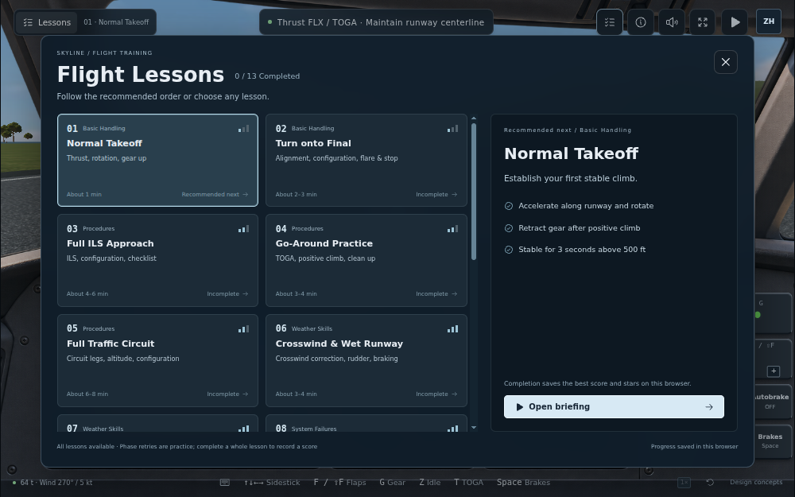

# Pilot Sim

**[Play online](https://renorzr.github.io/pilot-sim/) · [简体中文](README.zh-CN.md) · [MIT License](LICENSE)**

An A320-inspired airliner game for the browser: cockpit and exterior views, live instruments,
real-time 3D scenery, simplified flight physics and 13 progressively harder lessons.
Switch the entire interface **and pilot/tower recordings** between Chinese and English. Chinese voices are selected from E, G, H, J and Xiaoxiao. One pilot stays with the flight; departure and destination controllers are selected independently and may match each other, while remaining different from the pilot. Pilots sound dry inside the cockpit and use live VHF outside; controllers always use VHF. English retains its existing voice profiles.


This is a browser flight game with synthetic aircraft performance. Training
uses fictional terrain; the real airport scenes use public geography and simplified
buildings/procedures. It is not a certified simulator or an aircraft operating guide.

## Three stages

- **Flight Training**: the existing 13 lessons and their saved scores.
- **Airline Operations**: Six airports — Beijing Daxing, Hangzhou Xiaoshan, Singapore Changi, Osaka Kansai, New York Kennedy and Los Angeles — connected by 30 directional flights on an offline world map, plus 12 standalone airport practices.
- **Historical Scenarios**: US Airways 1549 — make crew decisions after a bird strike, take control for a continuous Hudson River ditching, then maintain flotation for evacuation. Guided/challenge modes and unscored final-approach practice have separate records. Includes original bilingual crew recordings and marked opening/rescue presentations.

Choose departure and destination on a Pacific-centred world map. Great-circle
routes cross the date line correctly; route focus includes polar arcs. Flights
start at a real stand with an airport aerial view and automatic crew preparation.
Taxi manually or skip to the runway-external holding point; entry, lineup and
takeoff still require separate clearances and manual control.

| Airport | Code | Playable runway |
| --- | --- | --- |
| Beijing Daxing | ZBAD / PKX | 17L |
| Hangzhou Xiaoshan | ZSHC / HGH | 07 |
| Singapore Changi | WSSS / SIN | 02L |
| Osaka Kansai | RJBB / KIX | 06R |
| New York Kennedy | KJFK / JFK | 22R |
| Los Angeles | KLAX / LAX | 25R |

In a positive climb, retract the gear; above 500 ft select CL with L. Follow
ND/FD along runway heading, then turn onto the destination route at the safe
turn point. Pass the departure waypoints in order: after the last point, cruise
skips automatically once departure is stable at the displayed clearance altitude.
If not yet stable, maintain the outbound track until it is; guidance continues
forward. **Skip cruise early** remains available once stable. After the destination showcase, arrive from the origin city direction
at 210 kt, with gear up and flaps 0. Follow the arrival route to final, then arm
APPR, configure and land. A go-around continues the same flight. Vacate at taxi
speed and follow ground navigation to the assigned real stand, or choose
**Skip remaining taxi** after clearing the runway. The crew handles shutdown;
the flight ends on stand. AP1 is optional. Long cruise/most descent and optional
taxi skips are explicit game transitions. Airport routes are simplified game
procedures, not published SID/STAR or operational airport charts.

Airline Operations also monitors sustained route deviations: beyond4 km for120 simulation seconds,8 km for45 seconds, or12 km for15 seconds fails the flight. The ATC panel shows distance and remaining time; normal fly-by turns have a grace period and terrain avoidance takes priority.

Airport showcases play in both cockpit and exterior views. Standalone airport
landing practice starts with a 10-second preview while flight physics stays
paused. Pause or skip the preview, then return to your selected camera view.

All six airports use real runway endpoints, OSM footprints and Mapzen/USGS terrain.
Building detail and navigation procedures are simplified. Headings are true and
altitudes are heights above the airport. Data keep their own licenses; see the
[pack notes](game/src/airports/data/README.md) and
[Xiaoshan data notes](game/src/airports/data/XIAOSHAN.md) and [Changi data notes](game/src/airports/data/CHANGI.md). Local source progress
does not imply that the public game has been updated.

## Quick start

Requirements: **Node.js 22.12+**, npm and Git with symlink support.

```bash
git clone https://github.com/renorzr/pilot-sim.git
cd pilot-sim/game
npm ci
npm run dev -- --host 127.0.0.1 --port 5173
```

Open **http://127.0.0.1:5173/**. Click a lesson, read its briefing and start flying.
The assets and both radio packs are included; normal gameplay needs no API key,
account, external speech service or installed system voices.

`game/public/assets` is a relative symlink to `../../public/assets`. Preserve it
when cloning or copying the project, particularly on Windows.

## What you can fly

| # | Lesson | Objective |
| --- | --- | --- |
| 01 | Normal takeoff | Accelerate, rotate, retract gear and establish a stable climb |
| 02 | Turn onto final | Intercept from the side, configure, flare and stop |
| 03 | Full ILS approach | Capture LOC/G/S, complete checks and pass both stability gates |
| 04 | Go-around practice | Respond to the instruction, climb to 3000 ft and clean up |
| 05 | Full traffic circuit | Fly all five legs continuously, then land and stop |
| 06 | Crosswind & wet runway | Correct drift, align touchdown and manage braking |
| 07 | Rain & fog decision | Go around without visual reference, return as weather improves and land |
| 08 | Autothrust failure | Release THR LK, manage thrust manually and land |
| 09 | ILS signal loss | Recognize lost guidance and complete a visual landing |
| 10 | Flap jam | Use actual CONF 2, revised speed and the landing checklist |
| 11 | Engine-out return | Handle a takeoff engine failure and return on the remaining engine |
| 12 | Approach windshear | Escape or avoid the encounter, return and land |
| 13 | Dual-engine glide | Manage energy and configuration for an unpowered landing |

All lessons are selectable. Recommendations, best scores and stars are saved in
this browser. Landing lessons require a final runway landing and full stop;
a go-around continues into a coastal return rather than completing the lesson.
Phase retries are practice and do not replace whole-lesson records.

Airborne lessons start **off the runway centerline, gear up, flaps 0**, so you
prepare the approach yourself. FD provides guidance; AP1 is optional. A/THR
controls engine output separately from lever position. Failed equipment stays
failed through a go-around and return.



## Controls

Play in landscape. Portrait orientation pauses flight and shows a rotation prompt; return to landscape, then resume.

| Input | Action |
| --- | --- |
| ↑ / ↓ | Push nose down / pull nose up |
| ← / → | Roll left / right; use opposite input to level |
| Shift + arrows | Fine control |
| Drag the sidestick pad | Mouse/touch pitch and roll |
| Q / E | Rudder left / right; assistance is on by default |
| W / S | Increase / decrease thrust lever |
| Z / L / T | IDLE / CL / TOGA; T also starts a go-around or touch-and-go |
| F / Shift+F | Extend / retract flaps one detent |
| G | Landing gear |
| I / A | Arm APPR / toggle AP1 |
| D / U | Flight director / autothrust |
| B / M | Arm ground spoilers / cycle autobrake |
| C | Acknowledge a fault, then confirm the landing checklist |
| V / Space | Reverse after touchdown / hold wheel brakes |
| 1 / 2 | Cockpit / exterior view |
| Drag empty scenery / wheel or pinch | Orbit camera / exterior camera distance |
| P / H | Pause / help |
| R / K | Restart whole lesson / retry phase |
| X | 2× simulation above 1000 ft, outside a go-around |

Releasing the arrows centers the **stick**, not the aircraft attitude. Use
opposite input to reduce bank. Pause, help and loss of focus clear held controls.

## Aircraft views, weather and sound

- **Exterior aircraft:** original animated airliner with actual gear, flaps, spoilers, steering, control surfaces and independent engines. Exterior view follows from behind with a level horizon by default; drag to orbit and double-click to return behind the tail, including while paused. View choice is saved.
- **External instruments:** compact flight/engine/configuration data, the same physical controls, and optional live PFD/ND/FCU. Camera changes preserve the aircraft and mission.
- **PFD / ND / ECAM / FCU:** live flight data, vertical speed, ILS deviations,
  engine N1, actual gear/flap positions, targets and autoflight controls.
- **Shared terrain:** the displayed terrain also drives collision and terrain
  warnings. Stall alerts derive from angle of attack and actual flap position.
- **Independent engines and wind:** spool delay, asymmetric thrust, air-relative
  forces, gusts, windshear and wet-runway braking affect the flight model.
- **Radio:** event-driven pilot/tower exchanges, responsive ATC reminders,
  captions, radio static/PTT effects and priority safety calls.
- **Aircraft sound:** engine sound responds to actual engine state; reverse
  amplifies that same engine sound. Main/nose touchdown sounds scale with contact.
- **Cockpit motion:** touchdown, rolling and turbulence effects with persistent
  standard/reduced/off settings. Visual motion does not change flight physics.

Use **EN / ZH** at the top right to switch menus, briefings, instruments, help,
checklists, warnings, captions and recorded radio. The choice is saved. Switching
midflight keeps aircraft state and progress, replaying the current transmission
in the chosen language. Standard height and safety callouts remain in English.

## Build and test

From `game/`:

```bash
npm run test:flight
npm run build
npm run test:sites
npm run preview -- --host 127.0.0.1 --port 4173
```

The flight suite covers complete lesson flights, failure persistence, terrain,
controls, communications and localization. The static hosting adapter has its
own additional checks; the test commands report current totals.

Deploy **`game/dist/client/`** to a static web host. The build also creates
`dist/server/index.js` and `dist/.openai/hosting.json` for the optional hosting
adapter. Deployment, browser checks and optional speech regeneration are
covered in [Development](docs/DEVELOPMENT.md).

The public playable site is hosted entirely on **GitHub Pages** at
**https://renorzr.github.io/pilot-sim/**. Pushing `main` runs the Pages workflow:
install, tests, a build using the project URL prefix, then deployment. Images,
3D textures and both radio packs are served by GitHub.

## Project layout

```text
game/src/                 React UI, Three.js world and Web Audio
  aircraft/               Original animated airliner asset loader
  views/                  Independent camera rig, terrain/building avoidance
  sim/                    Force-integrated aircraft, controls, engines and weather
  missions/               Lessons, circuit/return routes and completion criteria
  comms/                  Radio scripts, timing, playback, priority and ATC feedback
  i18n/                   Shared Chinese/English presentation layer
game/tests/               Flight, hosting and localization tests + fixtures
public/assets/            Runtime images, recorded radio and shared safety callouts
ops/                      Browser checks, speech generation and deployment helpers
docs/                     Development guide and screenshots
```

See [PHYSICS.md](PHYSICS.md) for equations, state conventions, update flow and
model limits. The model uses fixed 100 Hz physics ticks. Guidance commands the
same attitude servos as manual control; it does not move the aircraft directly
or create thrust for failed engines.

## License and credits

[MIT](LICENSE) © 2026 renorzr. Dependency notices are in
[THIRD_PARTY_NOTICES.md](THIRD_PARTY_NOTICES.md); original aircraft, generated image and speech
provenance is documented in [ASSETS.md](ASSETS.md). This is an independent project
and is not affiliated with Airbus or an airline.

## Singapore Changi

Fly Runway 02L from real T3 stand A16. The scene includes source-based terminal footprints, Jewel’s glass dome, the classic control tower, three runway strips and an island-aware coastline. Other runway strips are scenery. The short V / V9 / W8 departure keeps ground play compact. Airport procedures, clearances and the final lineup alignment are simplified game choices. See [Changi source notes](game/src/airports/data/CHANGI.md).

## Global airport network

Kansai adds its artificial airport islands and long silver terminal, Kennedy its
terminal complex and Jamaica Bay coastline, and LAX its terminal area, Theme
Building and Pacific coast. Each has an independently sourced DEM, real stand and
curated ground route, two practices and 40 bilingual dialogue clips. See the
[Kansai](game/src/airports/data/KANSAI.md), [JFK](game/src/airports/data/JFK.md) and
[LAX](game/src/airports/data/LAX.md) data notes for source geometry, licenses and
modelling estimates. All other runway strips remain scenery. The game uses a
direct-distance cruise-time estimate and an explicit transition; fuel and
long-haul range are not modelled.

## Los Angeles city scenery

LAX includes georeferenced USDA NAIP2022 orthophotos, Dockweiler beach,
1,894,606 source buildings across the 60 km terrain, SoFi Stadium,
Kia Forum and 14 original Downtown towers. Repeated nearby homes share
flat/hip/gable templates with per-building dimensions, orientation and colours.
Complex nearby buildings retain source outlines/courtyards; ordinary middle
buildings share boxes, and distant low homes use source-derived district
massing. Missing heights and architectural details use deterministic estimates.
Nearby roofs share the terrain's bounded high-resolution NAIP cache.

The 160.4 MiB building pack loads only at LAX. Its `buildings-v2.json` manifest
records exact count, packed bytes,
height provenance, spatial coverage and hashes. All middle/distant variants
prepare before flight; detail warms 3.2 km around the camera in every direction.
Prepared model objects/arrays persist until world disposal, so turns/revisits
reuse them. Full source collision data remains resident independently of LOD.
Regional imagery covers the terrain, with nineteen 2048² detail tiles.
The terminal retains its curtain walls, roof services, jet bridges and shadows.
The 2022 imagery and 2026 geometry have separate dates; this is a believable
estimated scene, not a surveyed architectural model. See
[city source notes](game/src/airports/data/LAX-CITY.md).

## Hangzhou Xiaoshan city scenery

Xiaoshan now includes781,740 source buildings across the60km terrain, with
regional apartment/factory/village proportions, shared templates and persistent
near/middle/distant model caches. Dated native10m Sentinel-2 imagery supplies
ground colours, farmland and Qiantang River geography. The53.2MiB building pack
and15.3MiB image levels are entirely self-hosted. Most building heights are
programmatic estimates; the original07/stand251/terminal/DEM and scores remain.
Airport-keyed source geometry feeds contact, camera rays and obstacle warnings.
[Sources, dates and limitations](game/src/airports/data/XIAOSHAN-CITY.md).


Xiaoshan revision 2 samples roof colours inside source footprints at native
resolution, preserving blue/red panels. Conservative vegetation screening
removes stale-looking EAB estimates; every retained footprint/frame/height is
checked against v1. Native 10 m imagery remains a limit on individual roof detail.

## Singapore Changi city scenery

Changi adds 176,208 OSM source buildings across the 60 km terrain, including
apartment estates, landed houses and logistics buildings. Source heights/floors
take priority; missing values and facade colours use stable local estimates.
Shared templates and persistent prepared models reduce repeated loading.
The 13.7 MiB building pack loads only at Changi.

The 12.3 MiB local imagery pack uses cloud-screened 2025–2026 Sentinel-2 RGB
with 10 m native resolution, plus source coastline/island masks. It is a dated
composite, not sub-metre aerial imagery. The original terminal/Jewel/tower plan,
A16 departure and 02L remain intact, with glazed bridge detail and local shadows.
[Source dates, interpretation and rebuilding](game/src/airports/data/CHANGI-CITY.md).

## New York JFK city scenery

Mapped-city airports persist processed building/contact arrays, prepared model
arrays and visited imagery in browser IndexedDB. Later visits restore valid
versions directly; unavailable storage falls back to ordinary loading. This
reduces repeat downloads and CPU preparation while GPU uploads remain necessary.

Large building packs are included as versioned data parts and automatically
restored before tests/build. A fresh checkout needs no separate map downloads.

JFK adds 1,759,833 source buildings across the 60 km terrain, including Queens
housing, Brooklyn and Manhattan towers. Shared residential models, source
heights and persistent prepared caches extend the existing city pipeline.
The building download is 124.2 MiB. Local 2022 NAIP imagery totals 281.5 MiB:
0.6 m native sources become approximately 1.4 m airport / 2.8 m regional detail.
T4 roof services, rooflights and glazed bridges add original architectural detail.
[Sources, resolution and rebuilding](game/src/airports/data/JFK-CITY.md).

## Osaka Kansai city scenery

Kansai adds 1,107,260 OSM/Microsoft source buildings across the 60 km terrain,
with Japanese pitched houses, coastal apartments, warehouses and source-tagged
high-rises. Shared models, advance preparation and IndexedDB restoration reuse
the existing city pipeline. Buildings download as a 75.5 MiB pack.

The 98.5 MiB self-hosted GSI photo levels use approximately 0.99 m airport,
1.97 m coastal and 3.94 m regional tile pixels. Original survey resolution and
capture dates are not exposed by the tile service. Both artificial islands,
coastal holes, silver T1 roof and elevated bridge retain their source geometry;
passenger bridges receive glazing/framing and local sun shadows.
[Sources, interpretation and rebuilding](game/src/airports/data/KANSAI-CITY.md).

## Beijing Daxing city scenery

The Daxing world now extends continuous shared buildings across the full
regional terrain: northern village roofs, apartment estates and logistics blocks
use mapped footprints and source heights or stable estimates. Roof colours come
from actual footprint samples on the self-hosted **2025-10-13 Sentinel-2** mosaic
(native **10 m**). The selected copper/gold terminal, stand 107, taxi route and
runway 17L remain in place. Advance preparation, retained model identities and
processed IndexedDB caches reuse the shared city pipeline.
[Sources, limitations and rebuilding](game/src/airports/data/DAXING-CITY.md).

## Cruise-cut presentation

Manual and automatic cruise cuts use the selected B camera: cut overhead,
follow for one second, then smoothly roll into a close upward view and fade
at 8.5–9.5 seconds. The aircraft retains its actual pose, measured velocity,
configuration and current airport scenery. Game inputs are locked during the
transition; recorded pilot/ATC dialogue finishes before fade. Destination
preparation begins when cruise-skip conditions first qualify, with small corner
progress text. Full black holds until the destination showcase is ready, then
the airport introduction resumes with the player's selected view preserved.

## Source-mapped woodlands

All six mapped airport regions now include volumetric woodland scenery from OSM
forest boundaries. Original shared tree models use stable estimated placement,
heights and image-derived colours, with spatial LOD and processed-data caching.
Airport surfaces, roads, water and building envelopes stay clear; tree contact
and camera avoidance use the same source stands independently of visual LOD.
This pass covers mapped woodland areas, rather than every street or garden tree.
[Sources and implementation](game/src/airports/data/WOODLANDS.md).
