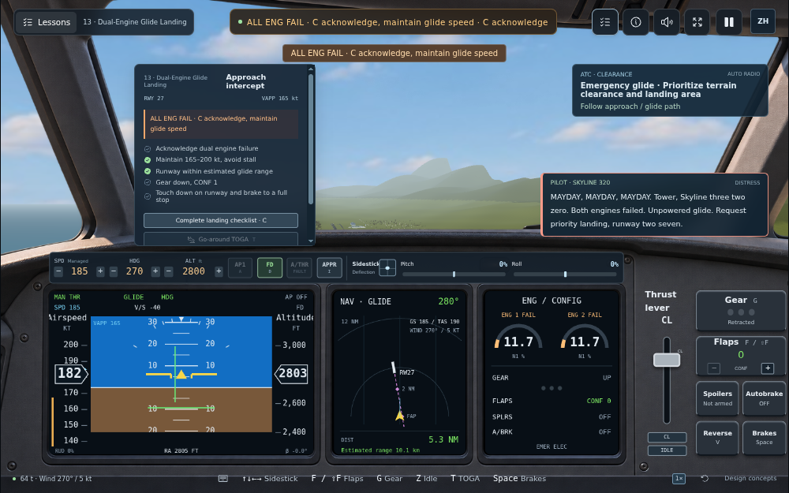

# Pilot Sim

**[Play online](https://flight.awsdev.renorzr.top/) · [简体中文](README.zh-CN.md) · [MIT License](LICENSE)**

An A320-inspired airliner game for the browser: a cockpit view, live instruments,
real-time 3D scenery, simplified flight physics and 13 progressively harder lessons.
Switch the entire interface **and pilot/tower recordings** between Chinese and English.



This is an entertainment prototype with fictional terrain and synthetic aircraft
performance. It is not a certified simulator or a guide to operating a real aircraft.

## Quick start

Requirements: **Node.js 22.12+**, npm and Git with symlink support.

```bash
git clone https://github.com/renorzr/pilot-sim.git
cd pilot-sim/game
npm ci
npm run dev -- --host 127.0.0.1 --port 5173
```

Open **http://127.0.0.1:5173/**. Click a lesson, read its briefing and start flying.
The assets and both radio packs are included; normal gameplay needs no API key,
account, external speech service or installed system voices.

`game/public/assets` is a relative symlink to `../../public/assets`. Preserve it
when cloning or copying the project, particularly on Windows.

## What you can fly

| # | Lesson | Objective |
| --- | --- | --- |
| 01 | Normal takeoff | Accelerate, rotate, retract gear and establish a stable climb |
| 02 | Turn onto final | Intercept from the side, configure, flare and stop |
| 03 | Full ILS approach | Capture LOC/G/S, complete checks and pass both stability gates |
| 04 | Go-around practice | Respond to the instruction, climb to 3000 ft and clean up |
| 05 | Full traffic circuit | Fly all five legs continuously, then land and stop |
| 06 | Crosswind & wet runway | Correct drift, align touchdown and manage braking |
| 07 | Rain & fog decision | Go around without visual reference, return as weather improves and land |
| 08 | Autothrust failure | Release THR LK, manage thrust manually and land |
| 09 | ILS signal loss | Recognize lost guidance and complete a visual landing |
| 10 | Flap jam | Use actual CONF 2, revised speed and the landing checklist |
| 11 | Engine-out return | Handle a takeoff engine failure and return on the remaining engine |
| 12 | Approach windshear | Escape or avoid the encounter, return and land |
| 13 | Dual-engine glide | Manage energy and configuration for an unpowered landing |

All lessons are selectable. Recommendations, best scores and stars are saved in
this browser. Landing lessons require a final runway landing and full stop;
a go-around continues into a coastal return rather than completing the lesson.
Phase retries are practice and do not replace whole-lesson records.

Airborne lessons start **off the runway centerline, gear up, flaps 0**, so you
prepare the approach yourself. FD provides guidance; AP1 is optional. A/THR
controls engine output separately from lever position. Failed equipment stays
failed through a go-around and return.


## Controls

| Input | Action |
| --- | --- |
| ↑ / ↓ | Push nose down / pull nose up |
| ← / → | Roll left / right; use opposite input to level |
| Shift + arrows | Fine control |
| Drag the sidestick pad | Mouse/touch pitch and roll |
| Q / E | Rudder left / right; assistance is on by default |
| W / S | Increase / decrease thrust lever |
| Z / L / T | IDLE / CL / TOGA; T also starts a go-around or touch-and-go |
| F / Shift+F | Extend / retract flaps one detent |
| G | Landing gear |
| I / A | Arm APPR / toggle AP1 |
| D / U | Flight director / autothrust |
| B / M | Arm ground spoilers / cycle autobrake |
| C | Acknowledge a fault, then confirm the landing checklist |
| V / Space | Reverse after touchdown / hold wheel brakes |
| P / H | Pause / help |
| R / K | Restart whole lesson / retry phase |
| X | 2× simulation above 1000 ft, outside a go-around |

Releasing the arrows centers the **stick**, not the aircraft attitude. Use
opposite input to reduce bank. Pause, help and loss of focus clear held controls.

## Cockpit, weather and sound

- **PFD / ND / ECAM / FCU:** live flight data, vertical speed, ILS deviations,
  engine N1, actual gear/flap positions, targets and autoflight controls.
- **Shared terrain:** the displayed terrain also drives collision and terrain
  warnings. Stall alerts derive from angle of attack and actual flap position.
- **Independent engines and wind:** spool delay, asymmetric thrust, air-relative
  forces, gusts, windshear and wet-runway braking affect the flight model.
- **Radio:** event-driven pilot/tower exchanges, responsive ATC reminders,
  captions, radio static/PTT effects and priority safety calls.
- **Aircraft sound:** engine sound responds to actual engine state; reverse
  amplifies that same engine sound. Main/nose touchdown sounds scale with contact.
- **Cockpit motion:** touchdown, rolling and turbulence effects with persistent
  standard/reduced/off settings. Visual motion does not change flight physics.

Use **EN / ZH** at the top right to switch menus, briefings, instruments, help,
checklists, warnings, captions and recorded radio. The choice is saved. Switching
midflight keeps aircraft state and progress, replaying the current transmission
in the chosen language. Standard height and safety callouts remain in English.

## Build and test

From `game/`:

```bash
npm run test:flight
npm run build
npm run test:sites
npm run preview -- --host 127.0.0.1 --port 4173
```

The flight suite currently contains **164 tests**, including complete lesson
flights, failure persistence, terrain, controls, communications and localization.
The static hosting adapter has four additional tests.

Deploy **`game/dist/client/`** to a static web host. The build also creates
`dist/server/index.js` and `dist/.openai/hosting.json` for the optional hosting
adapter. Deployment, browser checks and optional speech regeneration are
covered in [Development](docs/DEVELOPMENT.md).

## Project layout

```text
game/src/                 React UI, Three.js world and Web Audio
  sim/                    Force-integrated aircraft, controls, engines and weather
  missions/               Lessons, circuit/return routes and completion criteria
  comms/                  Radio scripts, timing, playback, priority and ATC feedback
  i18n/                   Shared Chinese/English presentation layer
game/tests/               Flight, hosting and localization tests + fixtures
public/assets/            Runtime images and 145 speech clips (83 shared/ZH + 62 EN)
public/designs/           Original generated design gallery
ops/                      Browser checks, speech generation and deployment helpers
docs/                     Development guide and screenshots
```

See [PHYSICS.md](PHYSICS.md) for equations, state conventions, update flow and
model limits. The model uses fixed 100 Hz physics ticks. Guidance commands the
same attitude servos as manual control; it does not move the aircraft directly
or create thrust for failed engines.

## License and credits

[MIT](LICENSE) © 2026 renorzr. Dependency notices are in
[THIRD_PARTY_NOTICES.md](THIRD_PARTY_NOTICES.md); generated image and speech
provenance is documented in [ASSETS.md](ASSETS.md). This is an independent project
and is not affiliated with Airbus or an airline.
