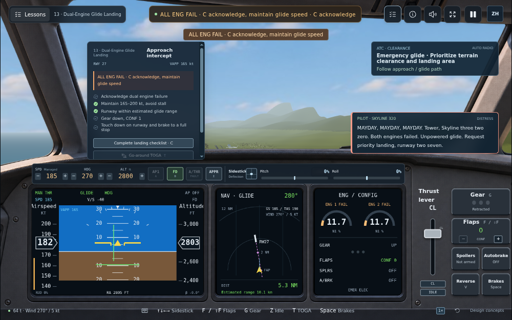
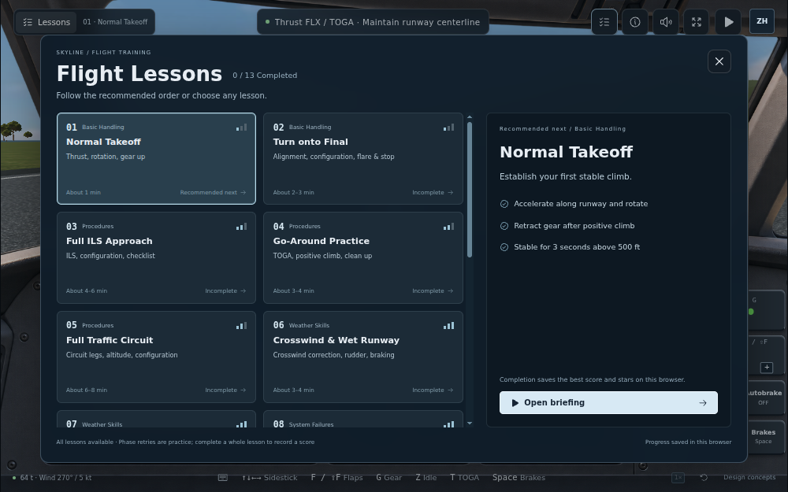

# Pilot Sim · 云际飞行

**[在线体验](https://renorzr.github.io/pilot-sim/) · [English](README.md) · [MIT License](LICENSE)**

一个受 A320 启发的网页版客机飞行游戏：驾驶舱内视角、实时仪表、3D 外景、
简化物理和 13 个由易到难的关卡。支持整体切换中英文，**包括飞行员和塔台录音**。



本项目用于游戏体验，机场和地形为虚构，飞机参数为简化预设，不用于真实飞行训练。

## 本地运行

需要 **Node.js 22.12+**、npm，以及支持符号链接的 Git。

```bash
git clone https://github.com/renorzr/pilot-sim.git
cd pilot-sim/game
npm ci
npm run dev -- --host 127.0.0.1 --port 5173
```

打开 **http://127.0.0.1:5173/**，选择关卡、阅读简报后开始。
运行所需图片和两种语言的录音均已包含，无需 API Key、账号或外部语音服务。

`game/public/assets` 是指向 `../../public/assets` 的相对符号链接；
克隆或复制项目时请保留该链接，Windows 环境尤其需要注意。

## 关卡

| 顺序 | 场景 | 主要目标 |
| --- | --- | --- |
| 01 | 正常起飞 | 加速、抬轮、收轮、稳定爬升 |
| 02 | 转入五边着陆 | 从侧方截获，完成构型、拉平、着陆停稳 |
| 03 | 完整 ILS 进近 | 截获 LOC/G/S，完成检查和稳定进近 |
| 04 | 复飞练习 | 响应指令、TOGA、正爬升、清理构型至 3000 ft |
| 05 | 完整五边飞行 | 连续完成起飞、绕场、进近和着陆 |
| 06 | 侧风湿跑道 | 修正风偏、对正接地、控制制动 |
| 07 | 雨雾决断 | 未目视时复飞，天气改善后返场着陆 |
| 08 | 自动推力失效 | 解除 THR LK，手动管理推力并着陆 |
| 09 | ILS 信号丢失 | 识别引导失效，最终完成目视着陆 |
| 10 | 襟翼卡阻 | 按实际 CONF 2、修正速度和检查单进近 |
| 11 | 单发失效返场 | 起飞后单发失效，使用剩余动力返场着陆 |
| 12 | 进近风切变 | 脱离或避让后，返场完成着陆 |
| 13 | 双发无动力着陆 | 管理滑翔能量、放轮和襟翼时机，无动力着陆 |

所有关卡都可直接选择。推荐顺序、最高分和星级保存在当前浏览器。
需要着陆的关卡必须最终在跑道接地并停稳；复飞会继续海侧返场，不会直接通关。
阶段重试仅用于练习，不覆盖整关成绩。

空中着陆关卡从跑道侧方、收轮、襟翼 0 开始，需要自行准备进近。
FD 只提供指引，AP1 可选；A/THR 实际推力与推力杆位置分开处理。
故障会持续到复飞、返场和着陆，不会因按开关或切换阶段而自动修复。



## 操作

| 按键／输入 | 功能 |
| --- | --- |
| ↑ / ↓ | 前推压机头／后拉抬机头 |
| ← / → | 左右滚转，反向操纵逐渐改平 |
| Shift + 方向键 | 精细操纵 |
| 拖动侧杆框 | 鼠标／触屏控制俯仰与滚转 |
| Q / E | 方向舵，默认开启辅助 |
| W / S | 增减推力杆 |
| Z / L / T | IDLE／CL／TOGA；T 同时用于复飞和触地复飞 |
| F / Shift+F | 襟翼放／收一档 |
| G | 起落架 |
| I / A | APPR 预位／AP1 |
| D / U | FD／自动推力 |
| B / M | 地面扰流板预位／自动刹车档位 |
| C | 确认故障，然后完成着陆检查 |
| V / 空格 | 接地后反推／按住轮刹车 |
| P / H | 暂停／帮助 |
| R / K | 重试整关／重试当前阶段 |
| X | 1000 ft 以上、非复飞期间切换 2× 速度 |

松键后自动回中的是侧杆，飞机不会立即自动改平。暂停、打开帮助或窗口失焦会清除按住的输入。

## 仪表、声音与语言

- PFD、ND、ECAM 和 FCU 显示实时空速、高度、垂直速度、ILS、N1、实际构型和目标值。
- 地形显示、碰撞和告警使用同一张地形网格；失速告警按迎角和实际襟翼位置判断。
- 双发动机独立处理状态、转速滞后和推力；阵风、风切变及湿跑道会影响实际飞行和制动。
- 自动飞行员／塔台通话带字幕、无线电杂音和按键音，空管会对持续偏离作出提醒。
- 发动机声音随实际状态变化；反推使用加大发动机原声的方式，接地分为主轮与前轮音效。
- 接地、滑跑和颠簸带来克制的驾驶舱晃动，可设置标准、减弱或关闭。

右上角 **EN / ZH** 可整体切换界面、简报、检查单、仪表文字、告警、字幕和通话录音。
语言选择会自动保存；飞行中切换不会重置飞机状态或关卡，当前通话会用新语言重播。
标准高度报数和安全告警继续使用英文。

## 构建与验证

在 `game/` 下运行：

```bash
npm run test:flight
npm run build
npm run test:sites
npm run preview -- --host 127.0.0.1 --port 4173
```

目前包含 **166 项飞行测试**和 **4 项静态托管适配测试**。
可将 `game/dist/client/` 部署到静态站点服务。
更详细的部署、浏览器验证和录音生成方法见 [开发文档](docs/DEVELOPMENT.md)。

可玩版本托管于 **GitHub Pages**：**https://renorzr.github.io/pilot-sim/**。
推送 `main` 后会自动安装依赖、运行测试、按项目子路径构建并部署；图片、3D 纹理、
中英文录音和设计画廊都由 GitHub 托管。

## 项目结构

- `game/src/sim/`：物理、操纵、发动机和天气。
- `game/src/missions/`：关卡、五边／返场航线和通关判定。
- `game/src/comms/`：通话脚本、时序、音频播放、优先级和空管反馈。
- `game/src/i18n/`：统一的中英文显示层。
- `game/tests/`：测试及必需的固定样本。
- `public/assets/`：图片和 145 段录音，含 83 段原始／共用录音与 62 段英文通话。
- `public/designs/`：最初的生成式设计方案。
- `ops/`：浏览器检查、录音生成与部署工具。

物理模型的方程、状态约定、模块关系与局限见 [PHYSICS.md](PHYSICS.md)。
物理以固定 100 Hz 步进；指引和自动驾驶通过同一套姿态操纵执行，不会直接修改位置或凭空产生推力。

## 许可证与素材

[MIT](LICENSE) © 2026 renorzr。
第三方依赖说明见 [THIRD_PARTY_NOTICES.md](THIRD_PARTY_NOTICES.md)，
图片与语音来源见 [ASSETS.md](ASSETS.md)。本项目与 Airbus 或航空公司无隶属关系。
