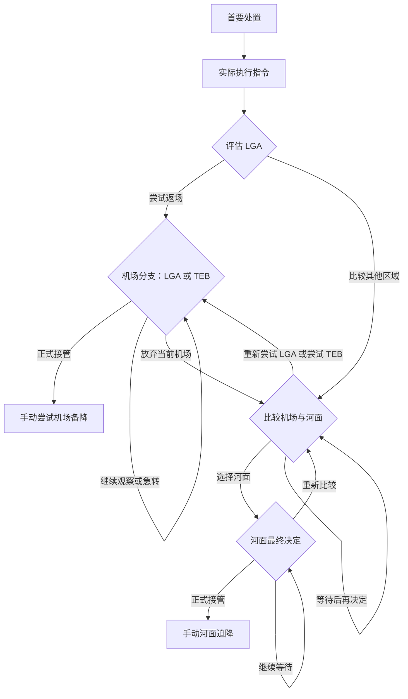

# 全美航空 1549 哈德逊河迫降关卡设计

状态：首版已实现（M1～M4），关卡版本 4。版本日期：2026-11-25。所属阶段：历史重现。关卡标识：`history-us1549`。

正式入口为“历史重现 → 全美航空 1549”。关卡位于 `game/src/history/`，水上受力位于 `game/src/sim/water-contact.js`。已接入连续机组决策、正式手动交接、引导/挑战、提前接管与末进近练习、原创中英机组录音、开场/救援演出、独立成绩和实际记录回放。

- 起点依据雷达表插值并转换 AGL/MSL；事件世界复用 JFK 自托管 NAIP/建筑源，水平坐标一致，水位为 MSL 0。LGA/TEB 目标、桥梁和示意船只使用共享渲染/碰撞几何。TEB 仅提供所需跑道表示，不宣称完整机场精模覆盖。
- 双发损伤不可恢复；副驾驶和玩家分别通过正常控制推进同一物理状态。有效决策需要实际执行证据，正式接管不补能量或瞬移。提前接管及末段练习不能恢复正式资格。
- 水上探针来自原模型的共享 `aircraft/contact-anchors.js`。机腹、发动机、机翼与收放轮参与首次接触、损伤、浮力、阻力和力矩计算；不借用轮胎摩擦、反推或普通跑道通关，也不锁定水面高度。
- 282 条录音共 5.03 MiB。中文保持 E/G/H/J/晓晓，英语 Guy/Aria/Andrew；机长、副驾驶、空管角色分开，角色跨重试保持。正常语速，MAYDAY 为连续同人三遍。来源、文本、时长、哈希见 `voice-assets.json`；运行时不需要服务凭据。
- 约 12 秒开场和救援演出使用独立视觉副本与时钟，可暂停/跳过，明确标注演出及时间压缩。正式记录从鸟击开始，在物理结果时封存；救援船和演出不会改写接触、结果或录制轨迹。
- 引导/挑战按模式、版本保存独立最佳成绩；练习不更新正式历史成绩、普通训练记录或星级。轨迹仅保存在本次会话内，可选水上记录通道保留既有回放列布局。

版本 3 的调校验收位于忽略提交的 `qa/us1549-v3/`；此前版本 2 的 95 分正式试飞和 5.9 m/s 练习记录保存在 `qa/us1549-m3/`，仅作旧版对照，不代表版本 3 的成功边界。版本 3 已通过完整回归；完整中文浏览器试飞以约 137 kt、2.66 m/s 入水并完成漂浮撤离，得 86 分，记录在 `qa/us1549-v3/full-browser.json`。实际浏览器返场在 LGA 22 以约 133 kt、1.77 m/s 接地，并在跑道内停稳，记录在 `qa/us1549-v3/return-browser.json`。首个拉平偏晚、下降率约 4.65 m/s 的失败尝试单独保留为对照，未放宽判定。当前单测增加 `game/tests/us1549-tuning.test.mjs`，检查收紧后的损伤/评分、气动能量、双向跑道、导航意图和控制输入返场。浏览器验收仍通过题卡、键盘、原生选择控件和捕获的侧杆输入完成，不设置飞机姿态、速度或成功结果。软件 GPU 下的长航段可仅在 QA 中暂停光栅绘制；完整地景碰撞、物理、UI 和音频继续运行，截图恢复绘制。 另通过 844×390 横屏触控检查，确认紧凑导航选择器和驾驶舱起落架按钮均可点击，且正式成绩仍保留。

### 水上迫降参数提示

手动选择河面后显示独立的只读参数卡；自由手飞在实际水面上方、低于 800 ft 时也显示，机场导航和备降滑跑不显示。引导/挑战与末进近练习均提供同一套建议范围，不打开自动驾驶或改变操纵。面板显示当前空速、水相对速度、下降率、俯仰、坡度、水相对侧滑、实际起落架位置和实际襟翼位置；其建议值来自 `sim/water-contact.js` 的 `WATER_ENTRY_TARGETS`，与入水质量计算共用。默认 68.5 t 下空速 120–135 kt、水相对速度不超过 135 kt、下降率 0–1.5 m/s（约 295 ft/min）、俯仰 8–11°、坡度和水相对侧滑均在 ±2° 内、收轮及 CONF 2。空速建议随实际重量按平方根缩放。这些是本关推荐入水目标，不是独立的生存硬门槛。

高于 800 ft 提示当前构型的滑翔参考，800–100 ft 提示进近参考，低于或等于 100 ft 标为拉平/入水阶段。前两阶段的入水速度/姿态目标保持中性色，避免为追目标提前减速或拉平；实际失速警告仍优先显示。起落架、襟翼读实际执行器位置，不把已按按钮视为构型到位。接触水面后固定显示首次入水快照，水上减速、漂浮及镜头切换不覆盖该记录。短横屏使用八格紧凑布局，并为驾驶舱 FCU、起落架、襟翼和触屏侧杆保留空间。实现见 `history/ditching-guide.js` 和 `history/DitchingGuide.jsx`，回归见 `tests/ditching-guide.test.mjs`。

水上参数提示验收位于 `qa/us1549-guide/`：完整回归 621 项、定向回归 44 项及发布适配检查全部通过；实际末进近练习完成水上迫降，浏览器采样确认进近、拉平、首次入水三阶段及冻结读数。中英两种视角在 1280×720、1024×600、844×390 共 12 个布局条件下通过边界、文字溢出与起落架按钮命中检查；触控选下放轮但执行器尚未运动时，参数卡仍正确显示实际 UP 状态。新增提示不改写成绩或飞行状态。

### 版本 4 的决策验收

验收文件位于忽略提交的 `qa/us1549-decisions/`：完整回归 614 项通过，末轮分支/历史关/语言定向检查 60 项通过。浏览器通过真实题卡在约 8.3 秒正式接管 LGA 22，约 133 kt、1.76 m/s 接地并在跑道内停稳；独立河面完整流程完成撤离并取得版本 4 的 86 分。844×390 触控和 1280×720 界面检查确认所有干扰选项可访问、切换语言/窗口保持排序、完整重开更新排序种子；触控放轮实际运行约 8 秒到位后可收回补救，无瞬移或直接判败，也不改写既有正式成绩。录音沿用原有已批准资源，机场交接仅复用适用的副驾驶确认，不冒充历史水上迫降通话。最后补充的 LGA 重新评估入口由定向回归覆盖，飞行受力参数未变。

### 版本 3 的调校与自由返场

- 保留正常任务的气动参数；本事件使用独立的分档襟翼升力/阻力、风车阻力和高迎角阻力。维持空速需要消耗高度，转弯、放轮/襟翼和拉平都通过正常受力消耗能量，不加入按时间强制减速。
- CONF 2 的常规进近参考约为 145 kt；水上最后 250～50 ft 的参考逐步降到约 130 kt。参考按事件质量和模型升力计算，仅是游戏指引；实际空速仍由操纵和受力决定。自由飞行及跑道备降采用各自的导航/参考，不套用河道末段减速。
- 入水综合损伤对下降率、横滚、俯仰、水相对速度/侧滑及发动机/翼尖先触水更敏感。约 125 kt、9.5°、3.8 m/s 的历史参照仍属于有损可生存样本；理想姿态下 6 m/s 的下降率、15° 横滚或 180 kt 水相对速度样本会达到致命区间。它们是游戏模型样本，不是独立通用安全限值。
- 高分窗口比物理生存窗口更窄，首次入水质量同时影响能量管理与入水/漂浮分。明显受损的成功结果明确标为“有损生存”；旧版宽松条件的最佳成绩保留在版本 2 记录中，不作为版本 3 的最佳成绩。
- LGA 04/22、13/31 与 TEB 01/19 共六个方向共享三条实体跑道。按实际航迹选择接触方向，既支持反方向着陆，也不重复绘制跑道。备降判定检查主轮、实际构型、速度、下降率、姿态和对正，滑跑还需在跑道内制动停稳。失败会显示实际原因和首次接触指标；转入水上或地面支持后清除仅适用于空中的旧失速/地形提示，实际碰撞检查继续运行。
- 手动阶段可选择“自由操纵”“哈德逊河水面”或具体跑道。选择只更改导航目标和相关提示，不接通自动驾驶或补充能量。安全备降记录真实接地指标；不授予哈德逊河目标星级，提前接管仍为练习。
- 候选估算采用与应急导航一致的转弯坡度，直线距离已包含的弦长不会再次作为整段转弯重复计入；保留风、对正、构型及能量余量。它仍是估算，不保证着陆成功。

`game/tests/us1549.test.mjs` 与 `us1549-experience.test.mjs` 覆盖正常/有损成功、过快和偏斜入水、持续后拉失速、地面/桥梁/船只接触、相邻损伤连续性、慢帧一致性、模式物理一致性、意图切换和资格隔离；其程序化初态属于数值模型验收。完整测试、媒体测量、构建和浏览器检查的日志保存在同一 QA 目录。

限制：桥梁尺寸、船位、气动/水动力系数及普通街区年代仍是明确的游戏估算。地面照片为 2022 NAIP；关键后建高楼轮廓被压制，但不是逐栋复原的 2009 年纽约。水上机体保持现有模型，不模拟动态断裂、乘客个体和真实救援耗时。事件来源说明为 `public/assets/maps/us1549-source.json`。

本关让玩家在低空失去几乎全部发动机推力后，先通过一系列选择题指挥副驾驶处置，再亲自完成哈德逊河水上迫降。鸟击后由副驾驶保持基本操纵，玩家判断处置优先级和可用着陆区域；确认水上迫降时正式接管。故障后的飞行连续进行，不跳过关键决策。

玩家也可以在决策阶段选择“提前接管 · 练习”。这会立即交出操纵权，但本次尝试永久标为练习，即使最终迫降成功，也不计入完整关卡完成，不解锁、不授予通关星级。该标记只在重新开始完整关卡时清除。

首版采用现有 A320 风格驾驶舱与操纵方式，新增纽约事件区域、水上接触与漂浮模型、专用任务判定及中英通话。真实飞机的全部系统与飞控律不在首版范围内，关卡介绍标为“基于调查报告改编的简化模拟”。下述各节保留首版设计和实现约束；当前交付范围、验收证据与限制以上述状态说明为准。

## 1. 首版设计取舍

| 项目 | 首版设计 |
| --- | --- |
| 入口 | 历史重现 → 全美航空 1549 → 哈德逊河迫降 |
| 默认起点 | 鸟击瞬间进入机组决策，副驾驶操纵；之前有可跳过的约 12 秒正常爬升开场 |
| 飞行时长 | 故障后约 3～5 分钟，取决于实际操纵；不设必须复刻的入水倒计时 |
| 总体验时长 | 简报、飞行、短撤离演出合计约 5～8 分钟 |
| 玩家职责 | 前半段选择处置与着陆策略；确认水上迫降后手动管理空速、航迹、襟翼、拉平与入水 |
| 自动职责 | 前半段按选择保持操纵、执行航向策略；全程处理应急呼叫、APU/供电、重启、检查单、客舱与救援 |
| 成功目标 | 哈德逊河可生存迫降，随后保持足够的漂浮与撤离条件 |
| 操纵权 | 决策阶段为副驾驶；确认水上迫降后为玩家。副驾驶自动操纵与 FCU 的 AP1 开关分别管理，不提供自动迫降 |
| 起落架 | 默认已收起；迫降过程中保持收起 |
| 襟翼 | 初始实际 CONF 0；玩家在合适位置逐级选择 CONF 2 |
| 游戏倍速 | 正式飞行阶段固定 1×；暂停可用；开场和救援演出可以跳过 |
| 模式 | 同一物理模型下的“引导”和“挑战”；仅提示强度、成绩标记不同 |
| 完整起飞 | 从拉瓜迪亚 04 跑道起飞的扩展入口留到后续，首版不增加滑行流程 |
| 提前接管 | 决策阶段始终提供明确的练习入口；本次不计完整关卡完成，不能中途恢复正式资格 |

“引导”默认向第一次体验的玩家开放。“挑战”可直接选择，不以通关其他章节作为硬门槛；建议先完成双发失效训练。

## 2. 史实基准与改编边界

### 2.1 必须保留的事实

2009 年 1 月 15 日，全美航空 1549 使用 A320-214，从纽约拉瓜迪亚机场飞往夏洛特。遭遇鸟群后，两台发动机几乎完全失去推力，飞机最终迫降哈德逊河。机上 150 名旅客和 5 名机组人员全部撤离；有人重伤，飞机严重受损，不能把真实结果写成“毫发无损”。[NTSB 事件概述](https://www.ntsb.gov/investigations/pages/dca09ma026.aspx)

真实航班从 04 跑道离场。鸟击发生在起飞后不久，之后机组尝试恢复推力，并与空管讨论返回拉瓜迪亚和前往泰特伯勒等选项；从鸟击到入水约三分半钟。[FAA 案例梳理](https://www.faa.gov/lessonslearned/transportairplane/accidents/N160US)

以下数值用于建立参考场景和验收样本，不构成要求玩家逐项命中的成绩目标：

| 基准 | 调查报告信息 | 设计用途 |
| --- | --- | --- |
| 鸟击高度 | 约 2818 ft AGL | 重建故障起点；不得把 AGL 不经转换直接当成 MSL |
| 离场重量 | 约 151510 lb，换算约 68.7 t | 质量量级参考；事件起点质量另作合理估算 |
| 水上迫降构型 | 起落架收起、CONF 2 | 专用构型目标，不沿用普通跑道的放轮检查 |
| 入水参考 | 空速约 125 kt、俯仰约 9.5°、横滚约 0.4°、下降率约 12.5 ft/s，即 3.8 m/s | 验证有损但可生存的判定，不能被普通硬着陆阈值直接排除 |
| 返场模拟 | 报告讨论了即时转弯和含识别、决策延迟的模拟；延迟 35 秒的那次返场尝试未成功 | 不以预知故障后立即转弯作为评价真实机组的依据 |

来源：[NTSB AAR-10/03，第 1.1、1.6.1、1.16.1、1.16.3、2.3.2 节](https://www.ntsb.gov/investigations/AccidentReports/Reports/AAR1003.pdf)。这些资料不支持“任何条件下机场都绝对不可达”的游戏结论。

### 2.2 首版采用的改编

- 开场、任务提示和通话为原创改写；不逐字复刻完整录音，不使用电影对白作为事实依据。
- 玩家在前半段担任决策者，以选择题指挥副驾驶操纵；确认水上迫降后成为操纵飞行员。这是游戏的职责分配，不宣称真实机长直到决定迫降才接管。
- 默认起点的地理位置、航向、速度和质量由事件参考档案统一管理；缺少足够精度的字段标明“估算”。地图示意图上量取的坐标不标成 FDR 原始数据。
- 首版可以把残余推力近似为零，但必须在场景说明中注明。真实事件是几乎完全失去推力，不能描述为两台发动机所有旋转和声音瞬间停止。
- 撤离与救援采用短演出，明确显示“随后”，不把几十秒的游戏演出当成真实救援耗时。
- 首版不做机场返场的可评分推演关。玩家若确实安全落在其他地点，记录实际安全结果，但不颁发“哈德逊河迫降”完成标记；不能为维持剧情而强制坠毁。

## 3. 玩家看到的流程

### 3.1 简报

关卡卡片展示日期、A320、纽约小地图和“鸟击后低空双发推力丧失”。简报用三句说明目标：

1. 鸟击后通过选择题指挥副驾驶，评估可行的处置和着陆地点。
2. 决定水上迫降时接管飞机，完成后半段飞行。
3. 想立即手飞，可以提前接管练习；该次不计完整关卡完成。

关卡名称可以展示历史结局，但决策阶段不立即画出唯一正确路线、提前预选河面，或把“转向哈德逊河”作为第一项强制任务。CONF 2 与入水姿态提示在迫降准备阶段再出现。

按钮为“开始”“引导 / 挑战”“返回”。“双发失效训练”作为可选入口。历史背景可展开阅读，不强制播放长介绍。

### 3.2 开场与进入决策

约 12 秒展示冬季纽约、正在正常爬升的飞机、驾驶舱仪表和发动机声音。画面明确标注“开场演示”，保留“跳过开场”。演示结束回到玩家此前选定的机内或机外视角，在鸟击发生时进入决策阶段，副驾驶继续操纵。

演示与跳过都进入同一个经校准的鸟击起点，不额外赠送高度、速度或提前转弯机会。决策与飞行记录从该起点开始。演示若使用实时飞行，也通过正常物理和自动操纵推进，不能用相机轨迹反向写入飞机运动。

鸟群、短促撞击声、一次受限颠簸、两台发动机参数下降建立故障感。机内可听到副驾驶报告“双发推力下降，我保持操纵”。界面显示“副驾驶操纵 · 等待你的处置指令”，随后给出第一道简短选择题。题卡为不遮挡仪表的半透明组件，不强制暂停。

### 3.3 实时飞行阶段

| 阶段 | 进入依据 | 玩家任务 | 自动机组和画面反馈 | 离开依据 |
| --- | --- | --- | --- | --- |
| 故障识别与稳定 | 鸟击实际触发 | 通过选择题确定首要处置 | 副驾驶保持可控空速，执行所选航迹策略；自动机组开始应急程序 | 已形成处置指令并有对应执行证据 |
| 机场与备选评估 | 飞机仍在空中，出现相关信息 | 选择返场、继续比较或评估另一机场 | 空管提供可用选项；副驾驶报告距离、能量与转弯代价，并按当前指令操纵 | 得到候选地点的实际评估，或候选因物理状态失效 |
| 迫降决策与交接 | 关键处置和候选评估已有记录，水面选项具有实际意义 | 选择“确认水上迫降并接管” | 当前状态下交出操纵权，机组通报意图；不瞬移、不补能量、不自动完成对正 | 正式交接事件已记录，玩家操纵从下一物理步起生效 |
| 河道建立 | 玩家已经正式接管 | 转向并沿河建立可用航迹，选择开阔水面 | 地图显示河岸、障碍及有限的可达性估算；副驾驶继续监控 | 实际进入可用迫降走廊且保持可控 |
| 迫降准备 | 剩余高度和距离进入构型窗口 | 逐级设置 CONF 2，保持起落架收起 | 客舱防冲击通知；副驾驶提示构型、空速和机翼姿态 | 构型到位并接近水面；准备不全也继续真实下降 |
| 拉平与首次入水 | 实际无线电高度降低 | 控制下降率、俯仰、横滚和横向速度 | 关键高度报数、接触声与水花；保存首次接触数据 | 扫掠检测发现真实水上接触 |
| 水上减速与漂浮 | 接触模型允许继续模拟 | 不要求新操作；保留观察视角 | 水阻减速、姿态变化、漂浮状态与撤离准备 | 形成可撤离状态，或结构/姿态恶化失败 |
| 撤离与救援 | 可生存迫降条件成立 | 观看或跳过短演出 | 机组自动指挥撤离，附近船只响应 | 演出结束，展示本次成绩与关键回放 |

表中的阶段用于组织指令、操纵权、提示和通话。完整关卡要求经过决策和正式交接，但不以“必须听完第几句”“必须经过某一个圈”作为前提。已作出的选择可以由状态证据确认，不必等待录音结束。

### 3.4 节奏控制

从鸟击到水上减速结束，保持连续模拟。无自动巡航跳转、恢复高度、瞬移到河面或定时入水。预计阶段时间只用于制作与测试，运行时以物理状态为准。

正式尝试固定 1×，倍速组件在这一阶段显示不可用及简短原因。暂停冻结物理、事件调度和当前录音进度；恢复时不重播已经说完的通话。后台切换、竖屏暂停遵循现有规则。

### 3.5 选择题的结构与执行

选择题表达机组指令，每题给出若干简短选项（含具有实际代价的干扰指令），选择后玩家角色发出对应指令，副驾驶确认并通过正常控制执行。稳定空速和转弯可以同时进行，不能把两者编成只能二选一的航空常识题。副驾驶始终负责基本操纵，玩家选择的是航迹策略、处置优先级和是否承诺某个着陆地点。

以下为当前版本 4 的决策骨架。具体选项根据当前可达性和已执行动作更新。每局生成独立的选项排序种子，按题目和稳定选项 ID 排序；UI 重绘、语言切换和条件选项变化不改变已有选项的相对顺序。检查点保留该种子，每次完整重开重新生成。记录选择时展示的顺序、高度和机场余量，方便复盘。

| 决策节点 | 给玩家的信息 | 可选指令示例 | 执行与代价 |
| --- | --- | --- | --- |
| D1 首要处置 | 双发推力下降，速度趋势、当前高度和航向 | “先稳住滑翔，评估落点” / “保持空速，立即小坡度转向返场方向” / “暂沿当前航向，留时间尝试重启” | 副驾驶维持可控飞行，但航迹不同；转弯消耗能量，沿原方向继续会改变各地点的可达性。供电和可行重启按机组程序并行推进 |
| D2 拉瓜迪亚返场 | 空管提供跑道，副驾驶给出距离、转弯与对正余量 | “尝试转向返场” / “暂不承诺返场，比较其他区域” | 尝试返场进入独立机场分支；可正式接管尝试备降、继续观察或放弃机场重新比较区域。LGA 试转选项在最佳跑道估算余量大于 −250 m 时显示 |
| D3 另一机场或河面备选 | 适用时提供泰特伯勒，并报告当前能量与开阔水面 | “评估泰特伯勒并转向” / “把河面作为首要备选，准备最终判断” / “暂不承诺” | TEB 进入独立机场分支，河面进入最终迫降决定。TEB 最佳估算余量大于 −500 m 时允许试转评估；门槛是游戏估算，负余量不等于承诺可达。LGA 仍有评估余量时也允许重新选择，放弃某机场不永久锁死该方案。等待执行 8 秒后可再决定 |
| D4 河面承诺 | 当前水面方向、余量、已评估的机场选项 | “确认水上迫降并接管” / “暂不承诺，延续当前指令” / “重新比较机场与河面” | 第一项构成河面正式交接；重新比较返回 D3，不恢复高度、时间或机场可达性。机场分支无需经过此题即可正式接管 |

干扰项不预先标记正误：首次处置可选择额外等待重启，机场和河面题可选择提前放轮，机场分支可选择 45° 坡度上限急转。放轮/收轮执行至少 8 秒，额外重启等待至少 12 秒，急转至少 10 秒；均还要求飞机距离指令位置至少 400 m。只改变控制目标和执行器选择，不直接改变位置、速度、高度、损伤或成功结果。放轮可通过后续收轮补救，急转执行完恢复正常坡度上限，继续等待不会刷过题数或恢复能量。新反馈以题卡状态文字呈现，不虚构未录制的通话。机场正式交接复用已有副驾驶交接录音，不播放“水上迫降”或“练习”台词。

决策阶段目标节奏为约 1～2 分钟，实际受选择、航迹和能量影响，不强迫等待某个历史秒数。任务控制记录 D1 的处置指令、至少一个机场候选的实际评估，以及最终迫降确认；无意义或已过期的候选可以基于状态跳过，但必须记录跳过依据。不能在鸟击第一帧直接提供“确认河面”来绕过整段决策。

题卡随有效条件出现，给出约 8～12 秒的初始阅读余量，仅用轻量提示表示当前等待指令，不做答题倒计时判死。未作答时副驾驶延续上一项有效指令和基本操纵，不替玩家选择最终落点，不暗中飞向最佳路线。选项失效时解释原因并更新题卡；需要紧急决策时可压缩说明，但不能靠加速录音腾时间。

错误或不合适的选择通过真实转弯、距离、高度和构型代价体现。选项不标成“正确/错误”，不因选错一次就弹失败；副驾驶可以报告“余量不足”，让玩家改变决定。若已经没有可生存路径，继续按实际飞行结果裁决，不额外制造故障或直接扣除高度。

### 3.6 正式接管与提前接管

河面正式交接在玩家按下当前有效的“确认水上迫降并接管”时生效；机场分支的“接管飞机，尝试机场备降”同样是正式交接，不转成练习，但机场安全备降仍不授予哈德逊河目标星级。无需再点第二次接管按钮，也不等待通话播放完。界面以短提示“你来操纵”明确交接，下一物理步切换控制来源；姿态、速度、位置、发动机损伤和实际构型连续保留，执行器按已有响应工作，不沿用副驾驶未执行完的转弯命令。

交接应发生在仍有实际操纵余量时。初始试飞以约 800～1200 ft 水面相对高度、尚需玩家完成转向或对正为目标窗口；该区间是游戏调校目标，不强行把飞机安排到固定高度。能量变差时提前提示决策，不能等副驾驶把飞机对正、放好全部构型、拉平后才交给玩家，也不能为给玩家腾时间补高度。

决策阶段始终显示“提前接管 · 练习”，旁边直接说明“不计本关完成”。点击后立即交接，不再弹确认窗。只有这个明确动作触发提前接管；查看地图、切换视角、触摸题卡或误按方向键不会把正式尝试变成练习。副驾驶操纵期间，飞行控制输入不直接作用于飞机，当前控制来源始终可见。

提前接管一旦发生，本次尝试的 `earlyTakeover` 标记不可逆，阶段切换、后续选择水面、语言切换、暂停、回放和重新显示题卡都不能清除。玩家可以自由飞行并查看实际迫降结果，但不能恢复副驾驶操纵后继续领取正式成绩。只有“重新开始完整关卡”恢复通关资格，并从鸟击起点重走决策流程；已取得的历史最佳成绩不受本次练习影响。

正式交接后的任何时刻都不再称为“提前接管”。提前完成有效的决策流程并正式确认河面，可以正常计分；不要求玩家等满现实中的约两分多钟。

## 4. 起点与飞行模型

### 4.1 初始状态

| 字段 | 设计要求 |
| --- | --- |
| 场景 | 专用纽约事件区域，以拉瓜迪亚离场及哈德逊河为核心；不从 JFK 跑道替代起飞 |
| 位置与航向 | 从报告航迹和可核对的地理资料建立；实现前存入带来源、坐标系与精度标记的参考档案 |
| 高度 | 以约 2800 ft AGL 量级建立鸟击起点，同时算出对应 MSL；仪表使用 MSL，水面/障碍判断使用真实相对高度 |
| 空速 | 首轮校准取约 215～220 KIAS；最终与起点位置、俯仰、爬升率一起验收 |
| 质量 | 事件起点暂取约 68.5 t，作为基于离场重量量级的游戏估算；不继续使用普通任务固定 64 t |
| 构型 | 实际起落架收起、实际 CONF 0；油门杆位置与实际发动机能力分别保存 |
| 天气 | 固定冬季白昼、良好目视条件、轻至中等西北风；具体风场依据报告观测建立，首版不叠加风切变或暴雨 |
| 供电与操纵 | 主要仪表保持可用，自动机组执行 APU/应急供电；不凭双发失效直接编造所有液压、屏幕和操纵同时失效 |
| 控制来源 | 初始为副驾驶自动操纵，读取玩家选择题生成的有效指令；不是玩家的 AP1 开关状态 |
| 成绩起点 | 单一固定参考状态；每次重试恢复相同条件和同一套人物身份 |

表中的空速、质量及后文提示窗口为游戏调校初值，未经物理飞行验收不能标成最终值。地理坐标与高度基准是实现前必须完成的数据工作，不以临时猜测坐标发布。

### 4.2 发动机受损

左右发动机独立记录损伤、转速、可用推力和重启结果。鸟击后分别衰减，不把两台 N1、声音和推力绑定为同一个数。保留风车旋转的显示与声音可能性；声音强度跟随实际状态。

在玩家操纵阶段，`T / L / W / S / U` 仍可表达原有推力和自动推力选择，但不能改变损伤事实；副驾驶操纵期间这些直接操纵输入不作用于飞机。选择 TOGA 不提供额外动力，不能进入普通复飞任务、生成成功结果或恢复发动机。自动重启尝试在该历史配置下无法恢复可维持飞行的推力。

副驾驶的重启动作有阶段与结果，不能在没有任何尝试后直接说“重启失败”。也不能为赶剧情，强制压低原本仍在爬升的物理状态；原有动能可以短暂换取高度。

自动机组按“维持操纵与供电、可行的重启尝试、迫降准备”安排优先级。检查单允许被更紧迫的任务打断，未执行的步骤保留为未完成，不因剧情推进自动打勾；没有完成整份双发失效检查单不阻止可生存迫降通关。

### 4.3 滑翔与能量

继续使用力积分。质量、密度、襟翼、起落架、发动机损伤阻力、风和坡度共同决定升阻与航迹。滑翔能力不足时，先核对这些输入和参考航迹，再调校对应机型参数；不得为保证通关添加隐藏升力或巡航推力。

引导模式在 PFD 空速带增加当前构型的滑翔参考标记与低速裕度；FD 只给出有限的俯仰和转向建议。挑战模式保留参考速度标记，隐藏建议转弯箭头和任务性口头教学。

参考速度必须由该质量、密度和实际构型下的模型得出。可以在开发初期以约 210～225 kt 的洁净滑翔区间、约 150 kt 的 CONF 2 机动参考作为试飞起点，但它们不构成固定考试门槛，更不能把真实入水的约 125 kt 设成全程目标。

可达范围估算需计入风、转弯损失、对正余量与构型阻力，随状态更新。显示“预计可达 / 余量偏小 / 预计不可达”，不显示保证落地的绿色圆圈。首版可仅计算少量候选区域，不必做复杂等时线；估算不能反向改变飞机位置或速度。

### 4.4 自动驾驶、APPR 与保护

- 玩家取得操纵权后要求手飞，AP1 不参与操纵；界面解释“玩家操纵阶段需手飞”，不把这个玩法限制标成未经证实的历史 AP 硬件故障。
- A/THR 的选择与实际可用推力分离，不能用恒速逻辑制造推力。
- 水面没有 ILS。APPR 不产生河面航向道、下滑道或自动拉平；简化滑翔 FD 必须明确标识为游戏辅助。
- 保留失速提示与现有基本操纵响应，不把通用简化保护宣称为完整 A320 正常法则。
- 玩家松开方向键后操纵杆按既有方式回中；回中不意味着自动恢复平飞。

以上手飞限制从正式交接或提前接管起生效。前半段副驾驶自动操纵是一套机组控制来源，通过正常控制指令与物理模型执行玩家选择；不以隐藏 AP1、速度锁定、位置插值或高度补偿实现。每个物理步只能有一个有效的操纵来源。

## 5. 迫降构型与交互

前半段使用选择题按钮，不要求玩家操作飞行杆、推力或应急面板；后半段保持现有方向键、虚拟操纵杆和 FCU 交互。玩家新增的认知集中在处置策略、“收轮水上迫降”和“没有推力时用姿态管理能量”。

下表中的直接操纵仅在玩家取得控制权后生效。副驾驶操纵时，杆和相关配置控件明确显示控制来源并停止接收直接飞行输入；地图、视角、暂停、题卡和提前接管仍可用。题卡按钮不获取焦点，点击后不吞掉随后的飞行按键，也不复用方向键答题。

| 操作 | 本关行为 |
| --- | --- |
| 方向键 / 虚拟杆 | 控制俯仰和横滚，保持现有自动回中与精细操纵方式 |
| Q / E | 保留方向舵；引导模式沿用现有方向舵辅助，不额外创造强制自动对正 |
| F / Shift+F | 正常逐级选择、实际执行襟翼；本关目标 CONF 2，不要求 FULL/3 |
| G | 起落架仍可操作；误放出时提示阻力与入水风险，不能暗中替玩家收回 |
| C | 可确认当前告警；不作为重启、APU 生效或后续任务推进的必按开关 |
| T / 推力选择 | 仅改变指令，受损发动机不恢复推力；不进入普通复飞成功逻辑 |
| B / M / 刹车 / V | 不要求跑道用自动刹车、扰流板预位或反推；水面制动不产生轮胎摩擦、反推或人为停车效果 |
| 视角与暂停 | 保留机内、自由环绕及暂停；切换视角不改变物理和通话进度 |

迫降准备采用“起落架收起、CONF 2、客舱已通知、入水区域无明显障碍”的专用检查。襟翼不足或放轮不直接触发脚本失败，而是通过升阻、水阻、接触顺序和损伤影响结果；符合物理的可生存结果仍可通关，构型问题进入复盘。

引导模式先确认河道基本可达，再提示构型变化。可用的初始提示窗口为：距预计入水区域约 2～4 km、无线电高度约 300～700 ft 且空速允许时，提示逐级选择 CONF 2。距离或高度单独满足都不足以发出固定指令；系统应检查剩余能量。窗口只用于减少新手过早放襟翼，不伪装成真实 QRH 的通用高度规定。

## 6. 纽约场景与可见地标

### 6.1 覆盖与坐标

建立独立的事件世界配置，覆盖故障起点、拉瓜迪亚、上曼哈顿、相关哈德逊河段、实际入水区域及减速/漂流余量。泰特伯勒作为空管讨论和地图判断所需的地理目标纳入覆盖。

沿用 WGS84 来源坐标并统一转换到事件区域的本地坐标系。渲染、河面、岸线、建筑、桥梁、船只和碰撞均消费同一地理配置。内部高度为米、航向按现有真航向约定；仪表单位与磁航向的转换不得混用。

现有 JFK 的数据管线、贴图处理和程序化城市模型可以复用；其实际覆盖范围须逐层核对，不能因为同属纽约就认为已包含拉瓜迪亚和哈德逊河。故障后不换机场世界，不在低空临时切换原点。

### 6.2 视觉优先级

| 优先级 | 内容 | 玩家用途 |
| --- | --- | --- |
| P0 | 连续准确的哈德逊河岸线、水面、曼哈顿与新泽西两岸体量 | 找到河道、判断宽度与入水方向 |
| P0 | 拉瓜迪亚跑道及机场轮廓、主要城市地形和实际航迹附近障碍 | 建立离场与返场的空间关系 |
| P0 | 对候选航迹有影响的桥梁、桥塔、桥面和码头 | 支持真实净空与碰撞判断；桥下空间不得用整块实心盒粗暴封堵 |
| P1 | 乔治华盛顿大桥、中央公园、曼哈顿中城与新泽西沿岸辨识点 | 在视线可见时帮助定位；不强制玩家经过桥梁或从桥下穿越 |
| P1 | 少量固定初态的渡轮、救援船及尾流 | 体现水面障碍和后续救援，避免随机不可解局面 |
| P2 | 不影响关键视线的远景建筑、道路活动和街区细节 | 增加城市层次，按 LOD 控制开销 |

所有标志性建筑都按实际观察位置和方向验收，不把完整纽约天际线贴在固定屏幕背景上。2009 年尚未建成的现代地标不以今天的完成状态出现在主视野；普通街区采用近似体量时，在资产说明中标明年代简化。无需逐栋重建全纽约。

### 6.3 水面与天气表现

使用冬季偏灰蓝河面、轻微风浪、适量反光和足够清晰的岸线。近水面保留可判断高度和运动的纹理；避免镜面反射吞没视觉参照，也不叠加巨浪增加虚构难度。

首版水接触采用统一基准水位，视觉波浪幅度受限，不得出现机身已经大幅入水而碰撞仍未发生。船只、桥梁与岸线关键碰撞数据在开始前准备完成；材质和远景可以分级加载，关键障碍不能延迟出现。

## 7. 水上迫降物理与结果判定

这是本关的首要新增能力。现有水面接触会结束失败，不能只把失败文字改成成功，也不能沿用跑道轮胎摩擦让飞机在河面滑行。

### 7.1 接触和状态

新增与普通跑道独立的水上状态：

`airborne → water-contact → water-run → afloat → evacuation → complete`

任意阶段可以因真实障碍碰撞、不可生存的冲击、倾覆或失去撤离条件进入失败。首次水接触不等于 `landed`，不触发普通跑道着陆、制动、滑行到机位或巡航任务。

接触检测沿用扫掠思路，扩展到机腹前中后部、左右发动机、机翼及放出的起落架。探针与当前飞机模型的接触锚点对应，俯仰和横滚影响接触先后；不能只看重心高度。水面、陆地、建筑、桥梁、船只分别分类，并取时间上最早的真实接触，不能因河面优先级高而吞掉撞桥或撞岸。

首次接触保存位置、接触部位、姿态、迎角、地速、空速、相对水流速度、下降率、侧滑/横向速度、构型、结构状态，以及该时刻的控制输入。后续复盘使用这个快照，不能使用减速后更好看的数据。

### 7.2 最小可用水动力

首版采用可调校的简化模型，不做完整流体求解：

- 入水部位根据浸入深度和相对速度产生支撑、水阻及力矩；仍在空中的机翼继续贡献相应气动力。
- 水平阻力随相对水速与浸入面积变化，可采用速度平方形式，并通过稳定的数值积分限制不合理冲量。
- 起落架放出、机头过低、单侧发动机或翼尖先入水会增加局部阻力和偏转/滚转风险。
- 加入简化浮力、姿态阻尼、浸水状态和剩余可撤离时间。冲击更重可以造成尾部浸水与更差的撤离条件，但不必直接全机爆炸。
- 水流影响接触相对速度及低速漂移；空气速度、对地速度、对水速度分别使用，不能用一个标量代替。
- 入水后不能强制把俯仰清零、锁定机翼水平或直接把速度插值到零；允许由物理产生减速、轻微偏航和姿态变化。

损伤只需数值和少量视觉反馈；首版不要求动态断翼、发动机脱落或完整机身破裂动画。若损伤足以破坏可生存条件，结果必须明确，不能仅保留一个无害的红色提示。

### 7.3 初始调校区间

下表是内部游戏调校初值，不是实际 A320 的适航、运行或生存界限。最终判断由接触顺序、冲击和持续状态共同决定，不能把各数值做成机械的全绿检查表。

| 指标 | 初始设计目标 | 越界处理 |
| --- | --- | --- |
| 入水俯仰 | 鼻部抬起，约 6～12° 为较优调校区间 | 更低可能机头扎水；更高可能先重击机尾并耗尽低速裕度；按实际接触处理 |
| 入水横滚 | 尽量接近 0°；约 ±3° 内作为较优区间 | 随单侧先触水、滚转和局部冲击加重风险，不以 3.1° 立即判死 |
| 入水下降率 | 约 0～2.5 m/s 为较轻冲击；约 2.5～4.5 m/s 允许形成有损但可生存的样本 | 更大下降率连续增加损伤；不能仅按普通跑道阈值裁决 |
| 入水空速 | 不设必须命中的单一数值；要保持可控并结合构型和迎角 | 过快增加水阻冲击；过慢会失去操纵裕度；以对应模型判断 |
| 横向水速 | 越小越好；暂以约 3 m/s 内作为较优区间 | 增加侧向载荷、偏航和倾覆风险 |
| 入水后的观察 | 连续模拟至减速且结构/姿态形成可判定状态 | 首次接触后必须覆盖至少 10 秒模拟时间；仍在高速滑行时继续，不按定时强行成功 |

真实事件参考入水组合约为 125 kt、9.5° 俯仰、接近水平机翼、约 3.8 m/s 下降率。该组合应能进入“有损但可生存”的调校验证区间，而非要求它取得满分，也不能要求玩家为了通关照抄这些数字。

从 `water-run` 转为 `afloat` 的调校初值为：相对水流速度降到约 5 kt 以下，横滚约 ±10° 以内且没有持续发散，连续保持约 3 秒；机体同时获得水上支撑，而不是正在反弹腾空。进入 `evacuation` 还要检查可用出口/机翼通路和浸水趋势，保守估算剩余可撤离窗口至少覆盖约 45 秒的简化自动撤离过程。这些时间用于游戏模型，不代表真实撤离耗时；阈值在 M2/M4 验收时统一确定并版本化。

### 7.4 成功与失败

“哈德逊河迫降完成”要求同时具备：

1. 完成有效的处置与候选评估流程，主动确认水上迫降并正式接管；本次没有提前接管或末段练习标记。
2. 鸟击故障真实发生，发动机没有被重试、按钮、自动推力或过场恢复。
3. 在哈德逊河可用水面完成接触；接受合理偏离历史入水点，不要求命中一个小圆圈。
4. 没有与岸线、建筑、桥梁、船只发生破坏生存条件的碰撞。
5. 冲击及后续水上运动后，机体仍有可用撤离路径，且剩余漂浮/撤离窗口覆盖自动机组所需时间。
6. 水上减速与观察已经完成，并进入自动撤离流程。

第 1 项属于完整关卡资格，其余属于飞行的物理结果。提前接管练习仍按相同物理标准评价可生存迫降，但结果必须标为练习，不更新正式关卡进度。

后段救援演出不再根据玩家没有控制权的随机事件改变成绩。进入撤离时先保存已满足的飞行结果，演出结束或跳过后显示完成。

失败依据实际状态：不可生存撞击、倾覆、严重浸水导致撤离窗口不足等。持续失速或航迹不佳先产生告警；只要仍然能够恢复并完成可生存迫降，不提前脚本判死。按 TOGA、转向河道、飞过目标区域、短暂碰水、暂停或跳过救援都不能单独创造成功。

落在其他水域或机场时，区分“安全结果”和“指定历史任务完成”。有能力判定时显示实际结果及目标未完成原因；缺少对应表面模型时不能凭位置自动授予安全着陆。以后开放假设推演，复用这部分证据并独立记录成绩。

## 8. 通话与机组协作

### 8.1 角色与音色

保留现有中英切换和已批准音色。一次尝试内固定玩家代表的机长声音；副驾驶使用另一固定声音；主要空管也固定且避免与同一场景的驾驶舱角色混淆。操纵权交接不改变人物音色，重试不无故换人。

中文可从现有五种音色中分配三个主要角色。英文保留现有飞行员与空管音色，新增副驾驶声音属于独立的录音制作与试听验收项，不能假定现有双角色素材已经覆盖；未完成前不得宣称完整英文机组录音已交付。

飞行员对空管的发话在机内使用干声，在机外使用实时 VHF；空管始终使用 VHF。副驾驶是驾驶舱内部协作，不能套用空管滤波；客舱广播使用独立的轻量 PA 处理。切换视角时仅改变正确角色的效果，不重启录音。

驾驶舱外不强制把所有内部协作都变成无线电；引导模式可以保留较低音量的副驾驶提示与字幕，挑战模式仅保留关键协作字幕。正常播放速度不为剧情压缩，Mayday 连续喊三遍，避免单独拼接成不同音色。

### 8.2 事件调度

历史顺序决定可出现的信息，实时状态决定现在是否合适播放。通话具有前提、优先级、有效期、一次性标记及可取消条件。

| 事件 | 触发条件 | 设计台词意图 | 失效与取消条件 |
| --- | --- | --- | --- |
| 双发异常确认 | 鸟击后两台可用推力持续下降 | 副驾驶简短确认，开始应急程序 | 已完成则不重复；不等玩家 C 确认 |
| 紧急呼叫 | 故障已确认，首个可用发话间隙 | 玩家代表的机长连续 Mayday 三遍，报呼号和双发失去推力；不因副驾驶正在操纵而换人 | 只触发一次；冲击或结果出现时取消未发出的长句 |
| 拉瓜迪亚选项 | 仍在决策阶段、机场选项尚有讨论价值 | 空管表示可提供紧急返场跑道 | 已明确承诺河面或低于有效沟通高度后不再要求掉头 |
| 重启状态 | 自动机组实际执行到对应步骤 | 副驾驶报告尝试和未恢复推力 | 不允许预先报告结果，不循环重启保证成功 |
| 泰特伯勒选项 | 仍处于候选判断阶段、该方向在空间上有意义 | 空管提供另一机场，机组结合当前能量回应 | 飞机已经进入最后入水阶段则过期，不把历史台词强行补播 |
| 指令与执行确认 | 玩家选择有效选项，指令已提交 | 机长发出相应指令，副驾驶确认；实际操纵不等录音播完才开始 | 重复点击去重；过期选项不执行、不补播 |
| 水上迫降决定 | 玩家确认当前有效的水面方案并正式接管 | 机长告知准备迫降哈德逊河；空管联络救援 | 不因飞机短暂指向河道就自动替玩家作出决定；已撞击则取消未开始的长句 |
| 正式交接 | 有效的河面决策提交 | 机长“我来操纵”，副驾驶确认并转为监控 | 控制来源立即切换，不能被录音缓冲或缺失阻塞 |
| 提前交接 | 点击“提前接管 · 练习” | 简短确认交出操纵；界面持续标记练习 | 不触发正式迫降决定或正式资格；与正式交接事件分别记录 |
| 防冲击通知 | 预计接触时间缩短，仍有发话时间 | 一次简短防冲击广播，客舱机组响应 | 真实接触发生后取消未开始的防冲击句 |
| 构型提醒 | 实际构型、速度及剩余能量需要提醒 | 副驾驶报告收轮、CONF 2 或低速风险 | 状态修正后取消过期提醒；避免每帧重播 |
| 撤离 | 水上运动已形成可撤离状态 | 机组自动组织撤离、提示可用出口 | 倾覆/失败分支取消成功撤离台词 |

首版用选择题输入机组指令，不要求玩家用麦克风、操作电台或额外输入对话。机长发话和副驾驶确认根据所选指令生成；空管许可本身不等于玩家已经接受。水上迫降决定必须来自显式选择，不能只靠观察航迹代替玩家决定或自动触发正式交接。

航迹判断只验证选择的执行效果和决定后是否需要风险提醒。例如，顺河航迹与可用河段方向相差约 20° 以内、预计接触点在开阔水面并持续约 3 秒，可确认“已建立河道”；持续转离约 5 秒或预测将撞岸时提醒偏离。不能把暂时转向其他方向解释为玩家撤销迫降决定、退回副驾驶操纵或恢复练习资格。最后低空阶段及时缩短提醒确认时间，以实际危险优先。

### 8.3 原创短句示例

下列为游戏改写，非历史逐字录音。正式制作时同时校对中英文、角色、触发条件和录音时长。

| 角色与情境 | 中文 | English |
| --- | --- | --- |
| 飞行员，初次紧急呼叫 | Mayday Mayday Mayday，Cactus 1549，遭遇鸟击，双发失去推力。 | Mayday Mayday Mayday, Cactus fifteen forty-nine. Bird strike. Lost thrust in both engines. |
| 副驾驶，决策阶段 | 我保持操纵，先稳住空速。请判断着陆去向。 | I have control. I'll maintain airspeed. Assess our landing options. |
| 机长，选择滑翔处置 | 保持滑翔空速，先评估可用落点。 | Maintain glide speed. Let's assess our landing options. |
| 空管，提供选项 | Cactus 1549，拉瓜迪亚可安排紧急返场。报告意图。 | Cactus fifteen forty-nine, LaGuardia is available for an emergency return. Say intentions. |
| 飞行员，河道意图已成立 | 无法返回。准备在哈德逊河迫降。 | Unable to return. Preparing to ditch in the Hudson. |
| 机长，正式接管 | 确认水上迫降。我来操纵。 | We're committing to a water landing. I have control. |
| 副驾驶，交接确认 | 你操纵，我监控速度和高度。 | You have control. I'll monitor speed and altitude. |
| 副驾驶，最终准备 | 起落架保持收起。襟翼二到位。 | Gear remains up. Flaps two set. |
| 飞行员，防冲击广播 | 防冲击准备。 | Brace for impact. |

“无法返回”和“襟翼二到位”只有对应条件成立才可播放。空管不把正常离场的高度保持、偏航惩罚和复飞指令套用于失去推力的飞机，也不要求它为服从许可撞向地形。

### 8.4 优先级与声音

优先保证短促的失速、碰撞风险和关键高度报数可辨认，必要时压低普通通话与环境声。仅水面接近造成的重复“低高度/起落架”提醒在已确认水上迫降阶段降频；真实桥梁、建筑、岸线风险与失速告警保留。不能用“正在迫降”关闭全部 GPWS。

发动机声音随左右实际转速衰减，风声和气流成为主要背景，保留合理风车旋转与 APU 表现。避免用低音量白噪音代替原发动机音色。首次入水使用明显的低频冲击与水花声，随后过渡至持续水阻和机身受力声音；不播放轮胎接地或反推音效。

驾驶舱颠簸分为鸟击、紊流、入水和水上滑行四类；幅度有上限，不改变真实飞机姿态。所有视角在最大位移和旋转下都不露白边、不穿出驾驶舱底图。

## 9. 仪表和任务提示

保留现有实体面板风格，虚拟操纵杆仍在左下角。任务信息使用既有半透明区域，最多同时展示三项当前目标，不盖住 PFD、ND、升降率和机外仪表。

| 显示位置 | 本关内容 |
| --- | --- |
| PFD | IAS、MSL 高度、无线电高度、下降率、姿态、参考速度与低速裕度 |
| 发动机显示 | 左右 N1、失效/受损状态、实际可用推力趋势；选择 CL 不代表发动机仍有 CL 推力 |
| ND | 实际位置、航迹、河岸和关键桥梁、LGA/TEB 方向；引导模式可显示建议走廊及带保留说明的可达性 |
| 当前目标 | 决策阶段展示当前问题与副驾驶执行状态；正式交接后强调空速、河道、收轮/CONF 2、机翼姿态和入水 |
| 阶段状态 | 空中滑翔、水上减速、漂浮/撤离；不使用“已落地滑行”描述河面状态 |

不显示“剩余 30 秒必定坠毁”式剧情倒计时。若提示预计接触时间，必须由当前状态估算、随操纵变化，并明确为估计。

引导与挑战使用相同初态、气动、水动力、故障、天气、碰撞和生存判定。引导可以有更多地图提示、简化 FD 与副驾驶建议；挑战移除教学性帮助。使用引导的成绩单独标识，不能靠关闭水阻、降低重力或隐藏额外动力降难度。

两种正式模式都保留决策阶段和交接条件。挑战不通过“鸟击后直接手飞”绕过决策；想这样体验应使用提前接管练习。正式交接前不显示已选中的唯一河面引导路线；可以查看河岸与机场等实际地理信息。

## 10. 成绩、回放与重试

### 10.1 通关与得分

先根据第 7 节判断物理结果，再检查决策流程和接管资格，最后计算正式分数。成功需要真实完成水上减速及可撤离判定，不能用分数平均掉致命碰撞，也不能仅凭安全入水跳过前半段决策。

| 维度 | 权重 | 主要证据 |
| --- | --- | --- |
| 决策与机组指挥 | 30 | 选择时掌握的信息、实际转弯/距离代价、发现不可行方案后的调整、最终迫降确认 |
| 手飞能量与航迹 | 20 | 交接后空速和低速裕度、转弯代价、剩余对正距离、避开岸线/桥梁/船只 |
| 构型与协作 | 15 | 收轮、襟翼实际位置与设置时机；自动机组动作不要求玩家逐步点确认 |
| 入水与后续状态 | 35 | 首次接触、冲击、侧向载荷、结构余量、漂浮/撤离条件 |

每项内部使用连续区间与事件证据，权重合计 100。1000/500 ft 正常稳定进近门、ILS 截获、起落架放下、反推、跑道中心线和滑行停车不参与本关评分。

选择题不按固定答案序列评分，不要求每个候选机场都实际飞过去；根据玩家选择时可用的信息和造成的实际结果评价。副驾驶执行基本操纵不计为玩家手飞成绩，但其执行所选策略造成的航迹和能量后果属于决策证据。记录正式交接时的状态，区分决策阶段损失与接管后损失，避免重复扣分。

版本 4 的决策分基础仍为首要处置 8 分、候选评估 12 分、正式交接 10 分；再根据有记录的后果扣分：不利放轮秒数（按实际放出比例加权）×0.14、主动急转且实际坡度超过 32° 的秒数 ×0.12、不利等待秒数 ×0.09，合计封顶 12 分。临近跑道（3.5 km 内、侧偏 600 m 内、航向误差 25° 内）的放轮不算过早放轮；首次重启尚未结束且高度不少于 1800 ft 时的等待不自动扣分。选择机场时估算余量低于 −100 m 的风险，以及低于 600 ft 才正式交接，另有连续扣分。这些是游戏评分估算，不是航空操作限制；评分不改变物理生存判定。新成绩使用修订号 4，旧版本最佳成绩保留但不混算。

结果分为“迫降完成”“迫降完成，机体严重受损”“迫降未成功”“未完成指定历史任务”。有损成功仍允许通关，不能因为没有轻柔入水就否定可生存结果。不根据简化模型虚构精确伤亡人数；显示机体状态和撤离条件即可。

提前接管单独显示“提前接管练习 · 迫降完成/未成功”，可查看操作反馈和参考数据，但不写入本关正式分数、最佳成绩、完成标记或星级，不自动推进下一关。物理上的成功和完整关卡完成分别保存。

### 10.2 复盘

复用现有会话内记录和关键片段回放，增加水上字段与事件。结果页先给结论和最重要的一条改进建议，再显示入水速度、俯仰、横滚、下降率、构型及漂浮状态。历史实际结果与玩家结果分栏，不互相覆盖。

建议选择五段真实记录：鸟击后机组处置、候选评估和最终决策、正式或提前接管、最后入水、水上减速与撤离。选择题记录同时保存题目版本、选项、作答时刻、当时状态和执行结果；回放明确标出副驾驶/玩家操纵区间及练习资格。回放不重新运行故障和水动力，不重新排队播放实时空管，不改变已保存成绩。救援演出若是预制表现，单独标成演出，不能伪装成本次飞行的真实轨迹。

复盘明确区分测得的玩家数据、历史参考值、模型估算和设计阈值，不用“你证明真实航班可以返场”之类结论。

### 10.3 重试

默认“重新开始完整关卡”恢复同一鸟击起点、场景种子、损伤配置和人物身份，清除本次提前接管标记并重新进入副驾驶操纵的决策阶段。额外提供“练习最后迫降”，从一个固定且声明为训练用的河面进场状态开始；该入口不计完整历史关通关成绩。练习内的局部重试不能清除练习身份。

完整尝试不得从失败前存档恢复高度、重置损伤后继续计分。水上失败后冻结结果和记录，不允许继续穿过河岸飞行。

## 11. 与现有架构的衔接

当前能力核对基于 `flight.js`、`sim/`、`missions/`、`terrain/`、`comms/`、`replay/` 及 [PHYSICS](../PHYSICS.md)、[Development](DEVELOPMENT.md)、[Replay](REPLAY.md)。以下为规划中的职责划分，文件名是候选，不代表新增模块已经存在。

| 能力 | 当前基础 | 本关的新增或调整 |
| --- | --- | --- |
| 任务注册 | `missions/catalog.js` 和历史重现占位页 | 新增历史任务分类和独立完成记录；不得计入原训练关或城市航线列表 |
| 事件控制 | 现有确定性故障、阶段事件和任务记录 | `history/us1549.js` 管理事件、阶段和证据；控制通过现有受力积分推进 |
| 选择题与控制来源 | 现有任务 UI、控制指令与姿态引导 | 决策图、有效选项、执行反馈、副驾驶指令控制器，以及正式/提前交接；副驾驶通过正常控制作用于物理 |
| 气动与发动机 | 质量、升阻、左右发动机、执行器和可用推力分离 | 事件质量与损伤档案、推力衰减和重启结果；不修改其他关的固定构型要求 |
| 水上接触 | 目前水接触进入碰撞失败 | 候选 `sim/ditching.js` 管理水动力与损伤，和表面分类/扫掠接触协作 |
| 世界与障碍 | 本地机场/城市数据、共享地形和障碍 | 独立事件区域、河道与桥梁等关键数据；复用管线并补足实际覆盖 |
| 导航与辅助 | 跑道/航线 FD、现有滑翔估算 | 独立河面目标和带转弯/对正代价的估算；禁止复用“拉向跑道”的默认逻辑 |
| 通话 | 事件优先级、录音、角色、实时 VHF | 专用中英脚本、副驾驶角色、状态条件、过期取消与救援收尾 |
| 记录与回放 | 会话内采样、关键事件、结果冻结 | 水接触/漂浮/撤离字段、表面类型、损伤与水流、首次冲击快照；保留跳转和尝试边界 |
| 存档进度 | 现有任务身份、版本和成绩 | 独立历史身份及配置版本；引导/挑战、提前接管、末段练习分开；练习不更新正式进度 |

任务状态建议包含：起点配置版本、鸟击时间、损伤种子、自动机组步骤、当前决策节点及版本、有效选项、选中指令、执行/过期证据、候选评估、控制来源、正式交接时刻和状态、`earlyTakeover` 不可逆标记、练习原因、迫降意图、实际水面区域、首次接触快照、水上阶段、损伤/漂浮状态、可用撤离窗口、帮助模式、物理结果及完整关卡完成资格。

不得用普通 `landed` 同时表达跑道接地和水面漂浮。需要显式表面类型与阶段，阻断普通 `landed → brake → taxi-in`、自动复飞、起飞过关和巡航切换的旁路。独立状态不得改变其他训练关和航线的表面规则。

本关不启用普通 SID/航线的偏离失败和巡航转场判定。紧急滑翔允许偏离原离场许可；桥梁、建筑、地形、岸线和船只的真实碰撞仍然有效。不要顺带引入地图边界、限制区或强制拉回航迹的机制。

## 12. 实施顺序与首版范围

### M1 参考档案与可飞区域

完成起点、航迹参考、LGA/TEB/河道和关键障碍位置，核对坐标与高度基准、资产覆盖和 2009 年主视野。用现有飞机实际滑翔验证主要空间关系。先确认河道可见、可达，地图和碰撞一致，再精细制作城市。

交付物：带来源和估算标记的场景档案、可加载事件区域、主要航迹与视线检查记录。

### M2 连续故障飞行与水上物理

完成左右推力衰减、自动机组状态、选择指令的物理执行、控制来源交接、水接触分类、水动力、损伤、漂浮和可生存结果。通过实际选择与真实操纵完成至少一条成功路线和有意义的失败路线。若这一阶段不可玩，不先用救援动画包装成已完成关卡。

交付物：无最终美术和录音也能连续飞完的内部关卡；水上模型和结果判定的可重复验证样本。

### M3 关卡体验

接入历史入口、选择题 UI 与条件分支、引导/挑战、提前接管练习、原创中英通话、完整音效、任务提示、短开场和撤离演出、成绩与真实记录回放。保留现有机内/机外操作布局。

交付物：可以完整评审的双语关卡、录音清单及测量时长、场景与媒体来源说明。

### M4 调校与回归

校准参考状态、速度裕度、构型时机、入水难度和任务节奏。完成键鼠/触屏、机内/机外、双语及原有关卡回归。按实测写入最终阈值与限制。

首版暂不包含：长距离巡航、登机/滑行、完整 A320 系统面板、实时 AI 或麦克风空管、完整乘客个体模拟、全纽约逐栋历史复原、动态机体断裂、救援船驾驶，以及机场返场的独立可评分推演。

后续可扩展：04 跑道完整起飞入口、可比较但独立计分的返场推演、更多损伤/水况，以及完整事件时间线查看。不要通过给首版加入随机额外故障来制造重复游玩差异。

## 13. 验收条件

以下为验收条件；数值单测与实际操纵的浏览器飞行分开记录。

### 13.1 物理与表面

- 左右故障、转速、实际推力和声音可分别追踪；任何推力/自动化按键都不能修好损伤。
- 同样的控制输入和初态在支持的帧率下产生一致结果，不因慢帧漏掉水接触或关键碰撞。
- 能实际飞到合理河段并可生存迫降；过早放轮/放襟翼、持续抬头和急转弯体现真实代价。
- 轻度横滚、不同俯仰、下降率、侧滑、起落架状态能改变首次接触及后续结果，不能全部得到相同水上动画。
- 低高度擦桥、岸线、船只及翼尖先入水均可检测；地图、视觉与碰撞在同一位置。
- 用入水参考组合验证可生存损伤区间，并测试相邻区间的连续变化；这只验证判定，不声称完整重现真实事故。
- 不能用重心未触水、河岸掩码缝隙、跨帧穿透或普通跑道范围检查绕过碰撞。

### 13.2 任务与公平性

- 完成有效决策、正式交接及水上减速、漂浮和撤离条件才通关；仅选择迫降、短暂碰水、按 TOGA 或转入河道均不过关。
- 副驾驶按不同选项通过正常物理产生可观察的航迹和能量差异；稳定空速与转弯可以同时执行，不被题目错误拆成互斥行为。
- 未答题时延续有效指令，不自动作出最优落点决定；过期候选会解释和更新，选错一次不直接脚本失败。
- 正式交接保留当时的实际状态，不补能量、不瞬移、不提前完成对正和全部构型；正常录音未播完不阻止控制切换。
- 收轮水上迫降不会因普通着陆检查缺轮、未用反推、未达 1000/500 ft 稳定门而被否决。
- 未命中精确历史入水点，但在合理河段安全迫降可以完成任务。
- 历史路线偏离、机场尝试及意图变化会改变提示和通话，不强行把玩家拉回原轨迹。
- 迟疑会消耗真实高度与距离，不通过额外倒计时或人为恶化发动机惩罚；预知故障也不获得“优于真实机组”的特殊评分。
- 有损但可生存的结果可通关；致命碰撞不能被高操作分抵消。
- 引导与挑战物理相同，成绩身份不同，都保留决策阶段；提前接管和末段练习不能生成完整关通关记录。
- 提前接管后，即使重新确认河面、切换语言/视角、暂停、回放或局部重试，仍不授予正式完成、星级或下一关推进；原有最佳成绩不被覆盖。

### 13.3 视听与交互

- 全流程中文/英文字幕、通话和角色一致；Mayday 连续三遍，正常语速，不为镜头时长加速。
- 飞行员的机内干声/机外 VHF、空管 VHF 与副驾驶内部协作正确分开；切换视角不重播。
- 过期机场选项、防冲击广播和成功撤离台词能取消；不能在失败后继续说已成功迫降。
- 低空真正障碍和失速有告警，确认水上迫降后不会被起落架等无效提示持续淹没。
- 任务窗不盖住关键仪表；水面最后接近时能看清高度、下降率与姿态。
- 选择题每题 2～3 项，点击/触屏可用且按钮不获取焦点；不会因方向键误按、视角切换或查看地图而意外进入练习。
- 前半段清楚显示副驾驶操纵，正式/提前接管时立即更新控制来源；交接前后的控制指令不叠加。
- 鸟击和入水颠簸不露白边、不改变物理轨迹；音效体现推力衰减、水上冲击和减速。
- 暂停、后台、竖屏恢复、录音未加载或播放失败不会让物理等待通话，也不会产生错误成功。

### 13.4 回放、重试与回归

- 回放显示本次实际入水和水上减速，保存首次接触数据，不重新模拟、不触发通话或计分副作用。
- 重新开始完整关卡恢复起点、副驾驶控制来源、故障档案和人物身份，并重新进行决策；前一次的选项、执行指令、水上状态、通话和成功标记不泄漏。
- 回放记录决策、执行结果、控制来源、正式/提前交接及资格；回放和退出结果页都不能改写本次练习标记。
- 原训练关、城市航线、正常跑道着陆、单/双发训练、起落架与反推、任务回放保持原有行为。
- 浏览器验收通过实际题卡选择和交接后的真实键盘/指针操纵完成流程；程序设置状态的数值样本只能作为模型测试，不能冒充端到端通关证据。

## 14. 参数与验收基准

这些是数据与调校任务，不要求玩家或用户预先选择。

| 项目 | 完成标准 |
| --- | --- |
| 地理与历史参考 | 起点位置/航向、实际河段、机场和障碍有来源、坐标系与精度；估算单独标记 |
| 质量与速度 | 在事件质量下验证升阻、参考速度和可达性，不照搬普通任务的固定速度 |
| 决策与副驾驶 | 每题有效条件、候选评估、默认延续指令、过期处理和后果明确；副驾驶通过正常控制实现指令 |
| 交接与资格 | 正式决策条件、交接余量、单一控制来源、提前接管不可逆标记、完整重试与正式成绩隔离验证通过 |
| 损伤推力 | 确定零残余推力近似或非对称残余推力方案，记录阻力、转速、声音的对应关系 |
| 水上模型 | 确定接触锚点、阻力/浮力参数、损伤累计、稳定性和撤离窗口；给出成功/失败边界样本 |
| 场景资源 | 分层核对 JFK 现有覆盖，确定新增数据与模型范围；主视野年代与关键碰撞验收通过 |
| 通话资产 | 所有条件分支有中英文本、正确角色、可用录音、时长及版本身份；没有录音不得假装已经播放 |
| 最终难度 | 至少包含正常成功、有损成功、低速失控、过快/偏斜入水、撞障碍及意图改变的验证记录 |

## 15. 参考资料

- [NTSB 事件页面 DCA09MA026](https://www.ntsb.gov/investigations/pages/dca09ma026.aspx)：事件性质、原因、结果与调查入口。
- [NTSB 最终报告 AAR-10/03](https://www.ntsb.gov/investigations/AccidentReports/Reports/AAR1003.pdf)：历史时序、飞机状态、轨迹、入水参数、返场模拟和生存因素。章节号优先于 PDF 阅读器页码。
- [NTSB 调查档案](https://data.ntsb.gov/Docket?NTSBNumber=DCA09MA026)：实现时核对轨迹、性能和原始附件的入口；未读取的附件不能被标成已核实来源。
- [FAA Flight 1549 案例](https://www.faa.gov/lessonslearned/transportairplane/accidents/N160US)：事件与操作背景梳理。
- [项目物理说明](../PHYSICS.md)、[架构与开发](DEVELOPMENT.md)、[现有回放机制](REPLAY.md)：可复用能力与当前边界。

资料核对日期：2026-11-24。新增地图、影像、录音与模型在实现时继续进入项目原有资产来源和第三方声明，不在本关偷偷引入运行时外部地图或 TTS 服务。
